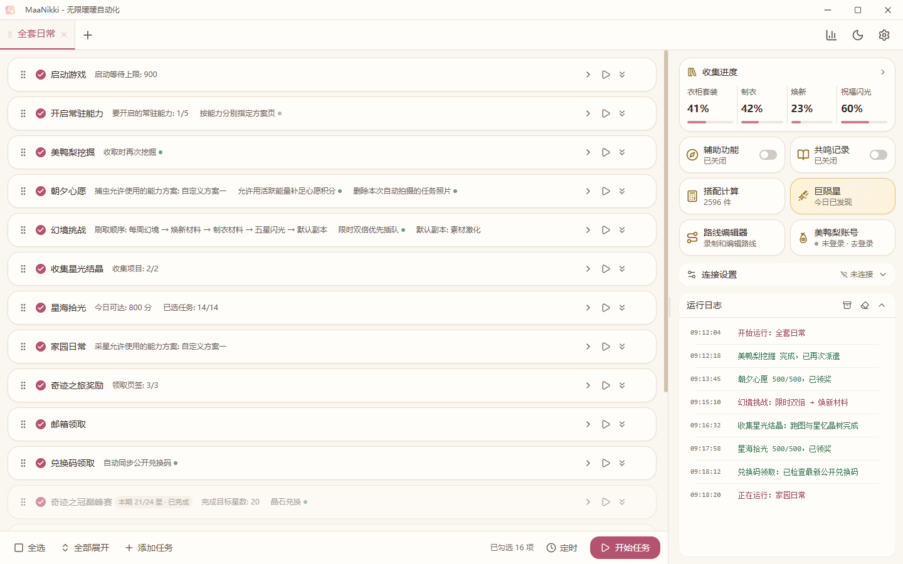
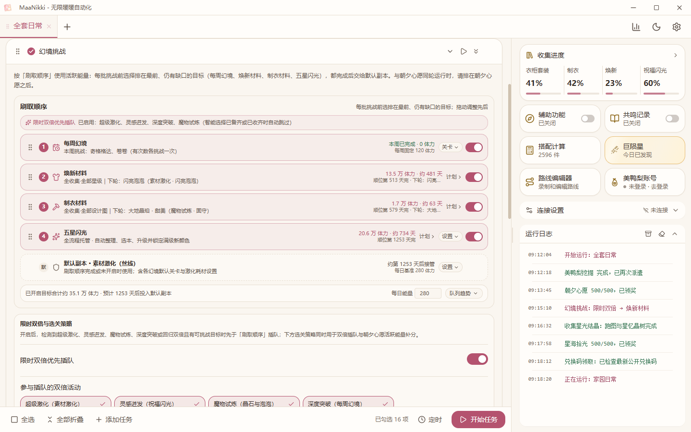
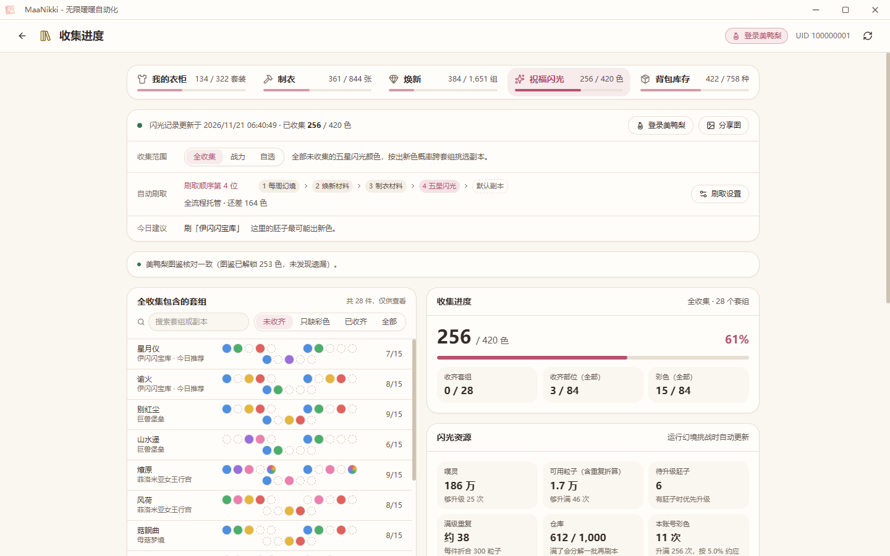
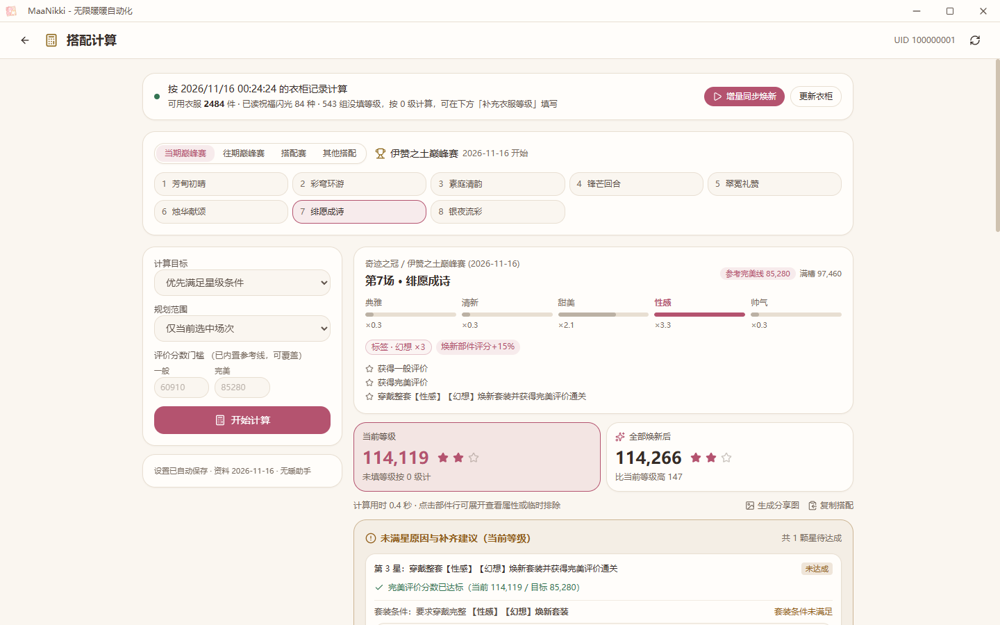
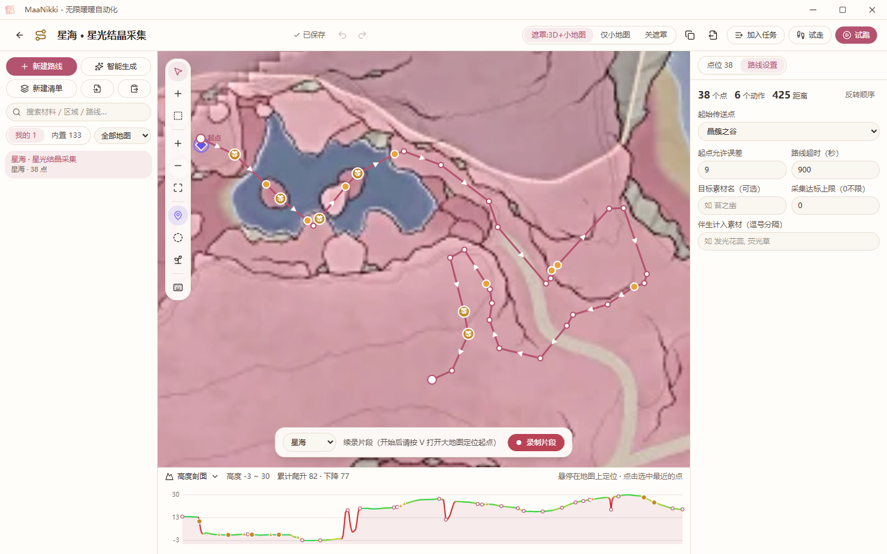
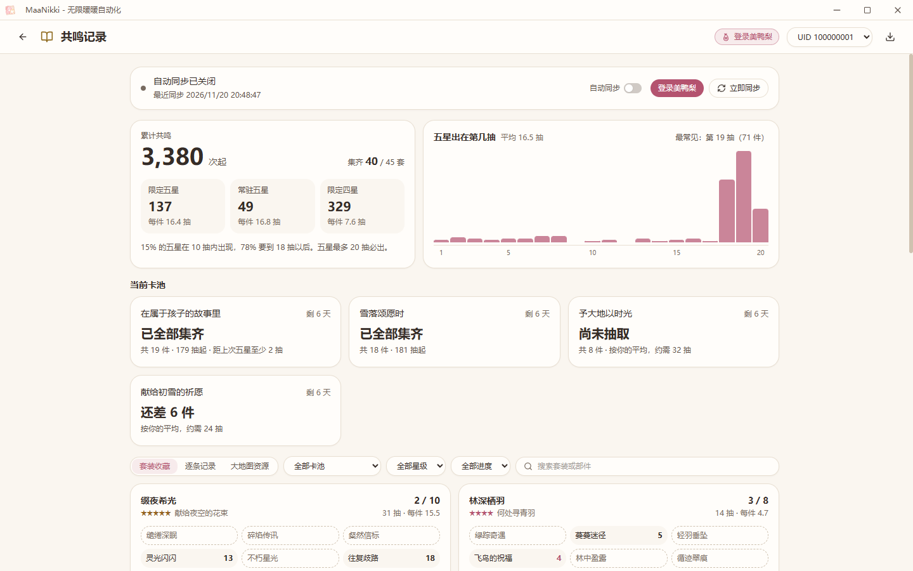

# MaaNikki

✨ 一款《无限暖暖》游戏小助手 ✨

基于图像识别与全向寻路，覆盖前后台日常自动化、多目标收集与养成规划、搭配计算、大世界采集刷噗灵、探索地图标记与路线编辑。

Powered by [MaaFramework](https://github.com/MaaXYZ/MaaFramework) & [MXU](https://github.com/MistEO/MXU)

[项目主页](https://maanikki.cn) · [下载最新版](https://github.com/architect9331/MaaNikki/releases) · [用户手册](docs/manual.md) · [更新日志](CHANGELOG.md)

## 下载与安装

前往 [Releases](https://github.com/architect9331/MaaNikki/releases) 下载 **Windows x64 运行包**，完整解压后启动 `MaaNikki.exe`。

[已有 Mirror酱 CDK？前往 Mirror酱高速下载 →](https://mirrorchyan.com/zh/projects?rid=MaaNikki&source=maanikki_readme)

首次使用请参阅[快速开始](docs/manual.md#快速开始)，配置游戏窗口、按键和任务预设。客户端与游戏数据（服装属性、巅峰赛排期、共鸣卡池、设计图与闪光资料）均支持自动后台检查与更新。

## 功能一览

- 📅 **日常与周期**：自动启停游戏，一键完成每日日常、星海与星光结晶、家园、巅峰赛、周期福利与兑换码。
- ⚔️ **多目标幻境**：统筹周本、焕新、制衣与五星祝福闪光全收集，自动响应限时双倍并按缺口顺次推进。
- 📚 **收集与规划**：同步衣柜与背包，统一追踪制衣、焕新与闪光进度，预估材料缺口与完成天数。
- 👗 **搭配计算**：按现有衣柜计算巅峰赛与搭配赛最高分方案，给出满星养成建议并一键加入刷取队列。
- 🧭 **探索与地图**：自动拾取、对白推进、跳过清洁与自动钓鱼；在游戏地图叠加美鸭梨未收集点位与实机攻略。
- 🌿 **采集与刷噗灵**：支持大世界材料多路线采集、一键开启常驻能力，以及小游戏连刷噗灵。
- 🗺️ **路线编辑器**：游戏内走一遍即可录制，在高清地图上调整点位、生成采集路线并试跑分享。
- 📊 **后台与统计**：支持后台运行、窗口适配、多配置定时与推送，内置冒险日报并同步美鸭梨共鸣记录。

⚔️ 看看幻境挑战与刷取顺序

📚 看看收集进度与衣柜规划

👗 看看搭配计算

🗺️ 看看路线编辑器

📊 看看冒险日报与共鸣记录

🌙 看看深色主题

## 使用说明

完整配置步骤、任务说明与常见问题统一收录在[用户手册](docs/manual.md)，欢迎按需查阅：
[快速开始](docs/manual.md#快速开始) · [日常任务](docs/manual.md#日常任务) · [幻境挑战](docs/manual.md#幻境挑战) · [收集进度](docs/manual.md#收集进度) · [辅助功能](docs/manual.md#辅助功能) · [路线编辑器](docs/manual.md#路线编辑器) · [常见问题](docs/manual.md#常见问题)

## 参与开发

欢迎提交代码、分享使用经验和完善文档。开发环境与打包流程见[构建指南](BUILDING.md)，模块划分与调试工具见[开发文档](docs/architecture.md)。

官网页面在 [MaaNikki-website](https://github.com/architect9331/MaaNikki-website) 独立维护，用户手册、截图和图标从本仓库自动同步。

## 交流与反馈

**QQ 交流群：654174255**

使用问题、功能建议，欢迎在群里交流，也可以提交 [Issue](https://github.com/architect9331/MaaNikki/issues)。

如果 MaaNikki 帮你省下了时间，欢迎点个 [⭐ Star](https://github.com/architect9331/MaaNikki) 支持我们！

## 致谢

- [MaaFramework](https://github.com/MaaXYZ/MaaFramework)：自动化框架。
- [MXU](https://github.com/MistEO/MXU)：桌面客户端基础。
- [Mirror酱](https://mirrorchyan.com/zh/projects?rid=MaaNikki&source=maanikki_readme)：高速下载与更新分发。
- [Whimbox（奇想盒）](https://github.com/nikkigallery/Whimbox)：部分基础功能实现参考。
- [CountingMomo](https://github.com/ChanIok/CountingMomo)：图鉴与仓库扫描时的无边框超长竖屏窗口拉伸思路参考。
- [无暖助手](https://nuan5.pro/)：搭配计算、制衣材料与图鉴资料参考。
- [MaaCommonAssets](https://github.com/MaaXYZ/MaaCommonAssets) / [PaddleOCR](https://github.com/PaddlePaddle/PaddleOCR)：OCR 模型。

感谢参与开发、反馈问题和分享使用经验的朋友！

## Star History

<a href="https://www.star-history.com/#architect9331/MaaNikki&Date">
 <picture>
   <source media="(prefers-color-scheme: dark)" srcset="https://api.star-history.com/svg?repos=architect9331/MaaNikki&type=Date&theme=dark" />
   <source media="(prefers-color-scheme: light)" srcset="https://api.star-history.com/svg?repos=architect9331/MaaNikki&type=Date" />
   
 </picture>
</a>

## 开源许可

本项目代码采用 **[AGPL-3.0-only](LICENSE)**。第三方组件及素材的许可与来源见 [THIRD_PARTY_NOTICES.md](THIRD_PARTY_NOTICES.md) 和 [licenses/](licenses/)。
