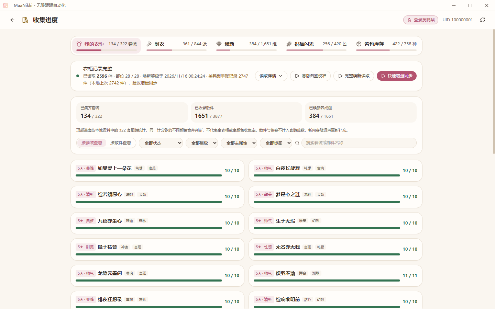
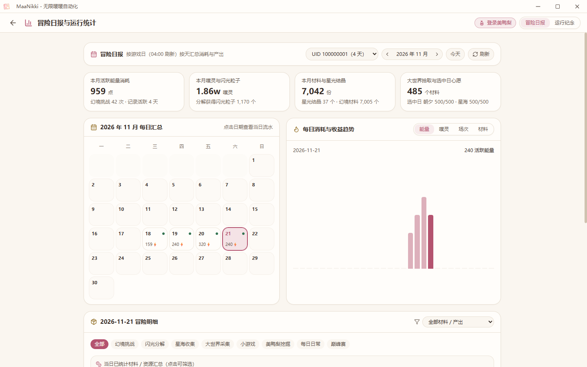
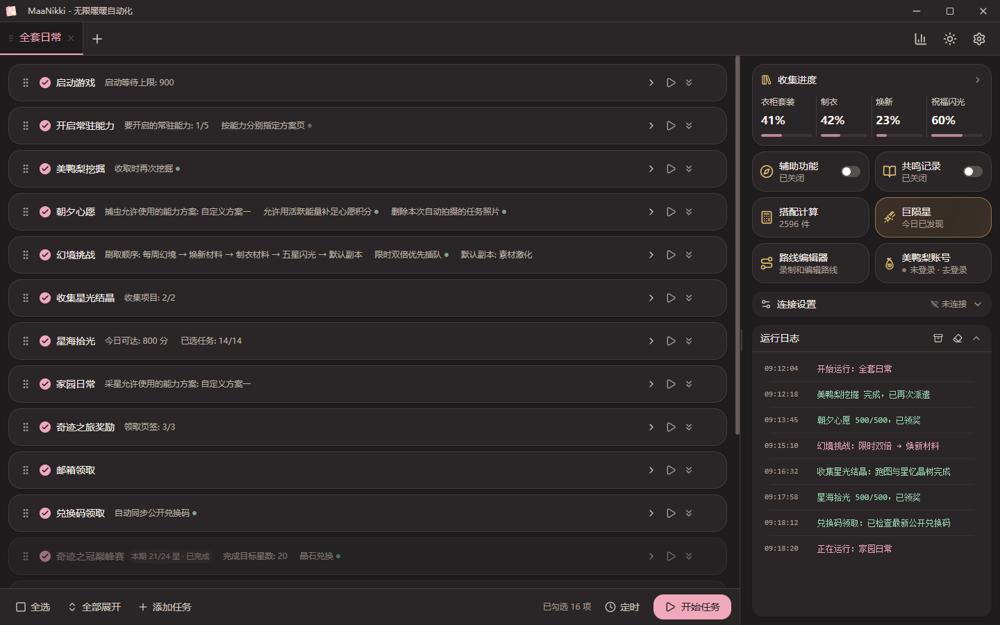

# MaaNikki

✨ 一款《无限暖暖》游戏小助手 ✨

基于图像识别与全向寻路，覆盖前后台日常自动化、多目标收集与养成规划、搭配计算、大世界采集刷噗灵、探索地图标记与路线编辑。

Powered by [MaaFramework](https://github.com/MaaXYZ/MaaFramework) & [MXU](https://github.com/MistEO/MXU)

[项目主页](https://maanikki.cn) · [下载最新版](https://github.com/architect9331/MaaNikki/releases) · [用户手册](docs/manual.md) · [更新日志](CHANGELOG.md)

## 下载与安装

前往 [Releases](https://github.com/architect9331/MaaNikki/releases) 下载 **Windows x64 运行包**，完整解压后启动 `MaaNikki.exe`。

[已有 Mirror酱 CDK？前往 Mirror酱高速下载 →](https://mirrorchyan.com/zh/projects?rid=MaaNikki&source=maanikki_readme)

首次使用请参阅[快速开始](docs/manual.md#快速开始)，配置游戏窗口、按键和任务预设。客户端与游戏数据（服装属性、巅峰赛排期、共鸣卡池、设计图与闪光资料）均支持自动后台检查与更新。

## 功能一览

- 📅 **全套日常与周期任务**：自动启动游戏（含官方启动器更新处理），一键完成美鸭梨挖掘、朝夕心愿、星海拾光、星光结晶与星忆晶树、家园日常与巨陨星提醒、奇迹之旅、邮箱与公开兑换码领取，以及每周免费礼包、每月五抽、奇迹之冠巅峰赛挑战与兑换、结束后安全关闭游戏。
- ⚔️ **多目标幻境挑战**：统一排序每周幻境、焕新材料、制衣材料、五星祝福闪光与默认副本，实时预估体力与预计天数；自动识别限时双倍优先插队，达成当前缺口后自动衔接下一目标。
- 📚 **收集进度与养成规划**：集中展示「我的衣柜」「制衣」「焕新」「祝福闪光」与「背包库存」五大页签，支持服装焕新快速增量同步与全量背包读取，按全收集／战力／自选分阶段规划材料缺口与走势预估，并支持美鸭梨核对与无 UID 分享图。
- 👗 **搭配计算与满星建议**：按已读衣柜计算当期与往期巅峰赛、搭配赛的单场或整期多场次最高分搭配，支持无限之心加成、未满星原因诊断与最少养成方案，并可一键将优先升级部件同步到幻境刷取队列。
- 🧭 **探索辅助与地图标记**：支持自动拾取、自动对白、清洁动画跳过与自动钓鱼；登录美鸭梨国服账号后在大地图与小地图扩展圈叠加未收集的奇想星、灵感露珠与各类宝箱标记，点击标记即可查看实机图文攻略（支持奇迹大陆、万相境、丹青屿、花焰群岛、无忧岛）。
- 🌿 **大世界采集与刷噗灵**：采用全向按键闭环寻路并支持 3D 地面 AR 路径引导；支持一键开启常驻能力、姜饼人多路线串联采集大世界材料，以及花愿镇「穿梭大冒险」小游戏连刷噗灵。
- 🗺️ **可视化路线编辑器**：游戏内走一遍即可录制路线与动作朝向，在高清平面地图上搭配高度剖面、材料点覆盖与流转之柱精细调整，支持智能生成姜饼人采集路线、任意点试走／试跑诊断及多路线清单分享。
- 📖 **共鸣记录与大地图资源**：自动同步美鸭梨国服共鸣历史，汇总累计抽数、五星分布、当期卡池进度与套装收藏（支持导出 JSON）；同步统计各大区域剩余宝箱钻石与奇想星／灵感露珠里程碑预估。
- 📊 **后台运行与任务管理**：支持非 16:9 窗口自动调整恢复、后台运行（WASD 后台寻路 + 瞬时借位点击）、多配置页签、定时执行与运行结果推送；内置「冒险日报」与任务纪念统计，提供 7 套游戏主题色与深浅色切换。

⚔️ 看看幻境挑战与刷取顺序

📚 看看收集进度与衣柜规划

👗 看看搭配计算

🗺️ 看看路线编辑器

📊 看看冒险日报与共鸣记录

🌙 看看深色主题

## 使用说明

完整配置步骤、任务说明与常见问题统一收录在[用户手册](docs/manual.md)，欢迎按需查阅：
[快速开始](docs/manual.md#快速开始) · [日常任务](docs/manual.md#日常任务) · [幻境挑战](docs/manual.md#幻境挑战) · [收集进度](docs/manual.md#收集进度) · [辅助功能](docs/manual.md#辅助功能) · [路线编辑器](docs/manual.md#路线编辑器) · [常见问题](docs/manual.md#常见问题)

## 参与开发

欢迎提交代码、分享使用经验和完善文档。开发环境与打包流程见[构建指南](BUILDING.md)，模块划分与调试工具见[开发文档](docs/architecture.md)。

官网页面在 [MaaNikki-website](https://github.com/architect9331/MaaNikki-website) 独立维护，用户手册、截图和图标从本仓库自动同步。

## 交流与反馈

**QQ 交流群：654174255**

使用问题、功能建议，欢迎在群里交流，也可以提交 [Issue](https://github.com/architect9331/MaaNikki/issues)。

如果 MaaNikki 帮你省下了时间，欢迎点个 [⭐ Star](https://github.com/architect9331/MaaNikki) 支持我们！

## 致谢

- [MaaFramework](https://github.com/MaaXYZ/MaaFramework)：自动化框架。
- [MXU](https://github.com/MistEO/MXU)：桌面客户端基础。
- [Mirror酱](https://mirrorchyan.com/zh/projects?rid=MaaNikki&source=maanikki_readme)：高速下载与更新分发。
- [Whimbox（奇想盒）](https://github.com/nikkigallery/Whimbox)：部分基础功能实现参考。
- [CountingMomo](https://github.com/ChanIok/CountingMomo)：图鉴与仓库扫描时的无边框超长竖屏窗口拉伸思路参考。
- [无暖助手](https://nuan5.pro/)：搭配计算、制衣材料与图鉴资料参考。
- [MaaCommonAssets](https://github.com/MaaXYZ/MaaCommonAssets) / [PaddleOCR](https://github.com/PaddlePaddle/PaddleOCR)：OCR 模型。

感谢参与开发、反馈问题和分享使用经验的朋友！

## Star History

<a href="https://www.star-history.com/#architect9331/MaaNikki&Date">
 <picture>
   <source media="(prefers-color-scheme: dark)" srcset="https://api.star-history.com/svg?repos=architect9331/MaaNikki&type=Date&theme=dark" />
   <source media="(prefers-color-scheme: light)" srcset="https://api.star-history.com/svg?repos=architect9331/MaaNikki&type=Date" />
   
 </picture>
</a>

## 开源许可

本项目代码采用 **[AGPL-3.0-only](LICENSE)**。第三方组件及素材的许可与来源见 [THIRD_PARTY_NOTICES.md](THIRD_PARTY_NOTICES.md) 和 [licenses/](licenses/)。
