# MaaNikki 用户手册

[返回首页](../README.md) · [更新日志](../CHANGELOG.md) · [问题反馈](https://github.com/architect9331/MaaNikki/issues)

欢迎使用 MaaNikki！从日常领奖到祝福闪光追全，按自己的习惯安排任务就好。

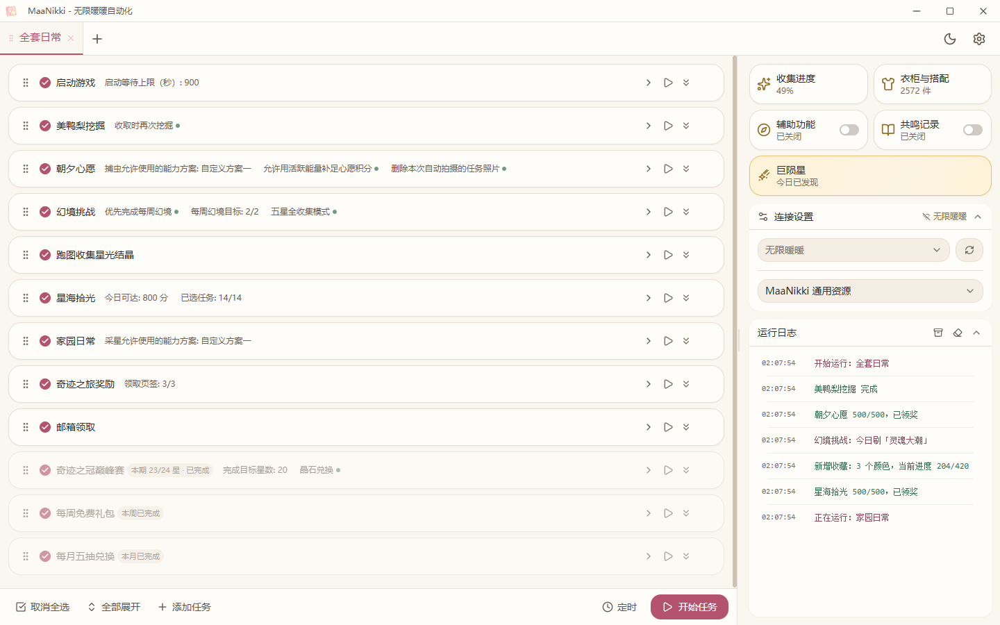

## 目录

- [快速开始](#快速开始)
- [主界面怎么用](#主界面怎么用)
- [日常任务](#日常任务)
- [幻境挑战](#幻境挑战)
- [祝福闪光全收集](#祝福闪光全收集)
- [收集进度](#收集进度)
- [衣柜与搭配](#衣柜与搭配)
- [辅助功能](#辅助功能)
- [路线编辑器](#路线编辑器)
- [共鸣记录与巨陨星](#共鸣记录与巨陨星)
- [设置](#设置)
- [更新、日志与反馈](#更新日志与反馈)
- [常见问题](#常见问题)

## 快速开始

1. 从 [Releases](https://github.com/architect9331/MaaNikki/releases) 下载 **Windows x64 运行包**，完整解压到一个文件夹，启动 `MaaNikki.exe`。
2. 阅读使用须知。第一次使用时，再选择想让软件处理的任务、是否追全祝福闪光，并确认准备事项。
3. 把游戏设为 **16:9**，推荐 **1920×1080**。如果改过按键，到「设置 → 任务设置 → 游戏键位」核对一下。
4. 确认相关地图、传送点、能力和关卡已经解锁，点「**开始任务**」。

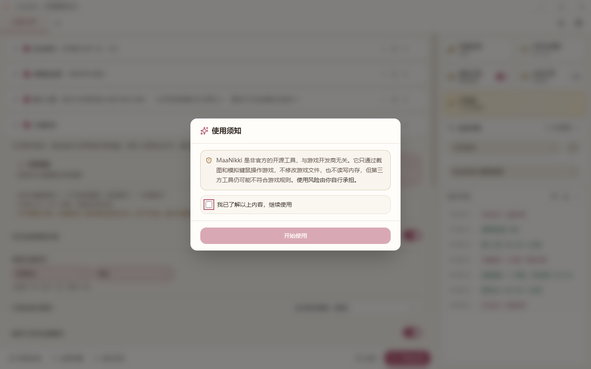

MaaNikki 是非官方工具，只通过截图和模拟键鼠操作游戏，不修改游戏文件，也不读写内存，但第三方工具仍可能不符合游戏规则，使用风险由你自行承担。

> 在用 Codex 或 Claude Code？可以在「设置 → AI 助手」接入，让它们帮你完成配置，详见[接入说明](https://github.com/architect9331/MaaNikki/blob/main/ai/README.md)。

## 主界面怎么用

左边是任务列表，右边是功能区、连接设置和运行日志。

### 运行任务

勾选任务后点右下角「**开始任务**」，从上往下依次运行。每个任务右侧有三个按钮：

| 按钮 | 作用 |
| --- | --- |
| `>` | 展开任务选项 |
| `▷` | 只运行这一个任务 |
| `⌄⌄` | 从这个任务开始往下运行 |

手动开始时，软件会提醒第一次全收集前清除仓库筛选、爆仓分解、移动键重复、启动器路径失效等情况。任务失败后，日志会列出可以检查的事项。

运行时请保持游戏在前台。切出游戏后默认暂停，切回继续；也可以在「设置 → 任务设置 → 游戏离开前台时」改为自动回到游戏。

### 添加任务和多套配置

点「添加任务」可以按分类添加任务，也能加入倒计时、系统通知、自定义程序等特殊任务。拖动左侧手柄可以调整顺序。顶部的 `+` 新建配置页签，保存另一套任务组合。

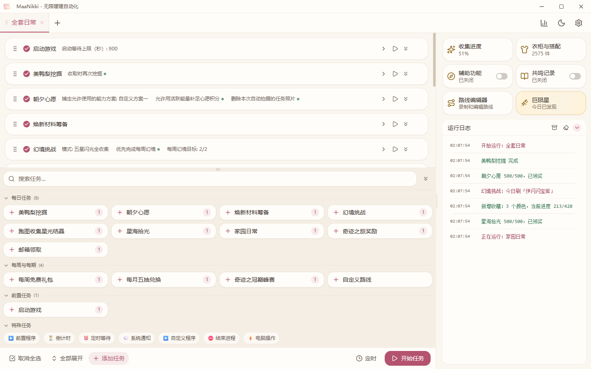

默认配置「全套日常」已经排好顺序：朝夕心愿在幻境挑战之前，跑图收集星光结晶在星海拾光之前，「启动游戏」最先执行。启动游戏可以填写官方启动器 `launcher.exe` 的路径，留空时自动查找。

### 定时执行

点「定时」设置运行时间，并保持 MaaNikki 运行。定时启动使用当前配置，游戏窗口、按键和前台要求与手动启动相同。

想在手机上收到结果，可以在「设置 → 通用 → 运行结果推送」填写 Server酱、Bark 等服务的地址。

## 日常任务

| 任务 | 会做什么 | 需要留意 |
| --- | --- | --- |
| 美鸭梨挖掘 | 领取奖励，默认沿用当前目标再次派遣 | 关闭「收取时再次挖掘」后只领奖 |
| 朝夕心愿 | 完成采集、捕虫、打怪、拍照等已适配项目，补足 **500 分**并领奖 | 小游戏和制作服装类心愿请手动完成 |
| 星海拾光 | 按勾选的子任务补足 **500 分**并领奖 | 展开选项可查看 8 天轮换表 |
| 跑图收集星光结晶 | 摇铃、定位结晶并选择路线采集 | 提前解锁所需地图与传送点 |
| 家园日常 | 钓星、下落攻击、点赞与领奖，并检查巨陨星提示 | 可设置采星能力方案 |
| 奇迹之旅奖励 | 分别领取旅行任务、旅行秘宝和乐园构想 | 三项可单独勾选 |
| 邮箱领取 | 领取邮件中全部可领取的附件 | 默认排在奇迹之旅之后 |

下面几项会按周期自动跳过，保留勾选即可。周期都以**北京时间凌晨 4 点**切换。

| 任务 | 会做什么 | 刷新时间 |
| --- | --- | --- |
| 每周免费礼包 | 领取虹迹赠礼、芳馨赠礼、星实置业之礼 | 每周一 |
| 每月五抽兑换 | 用静谧水滴兑换启示水晶、共鸣水晶各 5 个 | 每月 1 日 |
| 奇迹之冠巅峰赛 | 用游戏推荐搭配挑战已解锁关卡，默认目标 12 星，可设为 1～24 星 | 每月 1 日、16 日 |

巅峰赛的「晶石兑换」默认关闭，开启后按清单顺序兑换，商品名用逗号分隔。

### 小细节

**朝夕心愿**

- 「允许用活跃能量补足心愿积分」默认开启。需要幻境补分时，使用幻境挑战中设置的目标与材料。
- 升级祝福闪光心愿优先选择五星，其次四星、三星，成功升级一次即可。缺少噗灵或素材时结束升级。
- 任务照片默认保留，可在选项中开启自动删除。

**星海拾光**

已适配 15 项子任务：

| 类型 | 项目 |
| --- | --- |
| 互动 | 动物互动 3 次、不同动物互动、聚会聊天 |
| 拍照 | 拍照、星愿瓶合影、星芒之翼合影 |
| 操作 | 摇铃、放置摆饰、星绘图册点赞、更改音乐、召唤流星 |
| 收集 | 投递信笺、制造泡泡、收集星光结晶、漂流瓶查看 |

轮换表里缺分的组合会标黄，并显示需要开启或手动完成的项目。椰果采摘与拍照、星愿碎片投递与拍照、泡泡合影、海螺活动及跳上泡泡请手动完成。聚会聊天会向已识别的聚会频道发送一次配置中的消息。

**跑图收集星光结晶**

路线卡住超过 **30 秒**时，传送回起点重试，最多额外重试 **3 次**。跑完后日志会显示星之魄、星光结晶、星光微尘的今日累计和本趟新增。

**能力方案**

捕虫、钓鱼和家园钓星可以选择允许使用的能力方案。方案改过名也可以用，按游戏列表从上到下对应方案一、二、三，名称不要重复。

## 幻境挑战

先完成所选的每周幻境，再按顶部的模式处理剩余活跃能量：

- **日常消耗**：按「剩余活跃能量消耗方式」处理。
- **五星闪光全收集**：按缺色选副本，刷取后升级并锁定新颜色，详见[祝福闪光全收集](#祝福闪光全收集)。
- **制衣材料全收集**：每天首次运行先打开背包核对当前持有的晶石、泡泡、丝线与噗灵数量，再根据已读衣柜自动算出所有未制作设计图所需的 10 种魔物试炼晶石（5 种磐岩晶石 + 5 种大地晶珀），按缺口从大到小精准计算次数挑战；单种晶石刷齐后若当天仍有剩余活跃能量，同轮自动切换去刷下一种晶石。

如果需要为当期巅峰赛优先准备焕新泡泡、丝线或噗灵，可在搭配计算中点「**设为焕新筹备目标**」，由排在幻境挑战上方的独立任务「**焕新材料筹备**」优先按缺口次数刷取；无目标或已达标时该任务自动跳过，剩余活跃能量自动交给幻境挑战继续追闪光或追制衣。

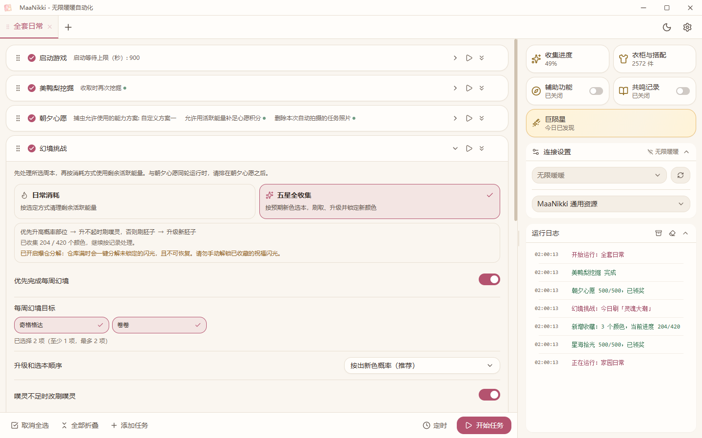

| 消耗方式 | 设置内容 |
| --- | --- |
| 素材激化 | 选择奖励，按数量最多或首选／备选顺序使用材料 |
| 普通祝福闪光 | 选择副本，快速挑战获取胚子 |
| 魔物试炼 | 按所需材料选择关卡 |

请提前解锁对应关卡、困难难度和快速挑战。暂未使用的目标收在「朝夕心愿补分备用设置」中，供朝夕心愿按当天要求使用。

## 祝福闪光全收集

### 第一次使用

1. 清除游戏祝福闪光仓库的筛选。
2. 提前锁定想保留的物品。
3. 在「**幻境挑战**」顶部切换到「**五星全收集**」，运行日常或幻境挑战。
4. 第一次运行会先整理全部祝福闪光，再选择副本刷取并升级。

### 每次运行会做什么

1. 处理每周幻境，读取已保存的进度。
2. 先升级仓库里已有的胚子。噗灵不够时，当天活跃能量全部刷噗灵，刷完接着升。
3. 胚子都升完后，选择最可能出新色的副本，用剩余活跃能量刷取一批。
4. 分解四星及以下未锁定闪光，再读取新增的胚子。
5. 按出新色概率从高到低升级。满级后识别颜色，锁定新颜色，重复颜色留作后续素材。
6. 保存结果，日志显示本轮新增颜色和当前进度。

中途被打断可以直接重跑，软件会先恢复相关部位的进度。缺噗灵或材料时会保存当前对象并正常结束，下次优先继续。

### 为什么推荐这样刷

每次升满要 360 闪光粒子和 72000 噗灵。粒子用完后，一键放入会把未锁定的胚子和满级重复项当作材料，所以重复项不必为了粒子分解。真正要靠时间积累的是粒子和噗灵，胚子相对容易获得。

- **按出新色概率升级与选本**：每次花费相同，缺色多的部位更容易出新色，只缺彩色的部位排到最后。
- **全流程托管与只刷胚子**：默认「全流程托管」负责整理、刷本、分解、升级并锁定满级新颜色，可设置「保留噗灵数」保证升级后剩余噗灵不低于设定值；若想自己手动升级与管理仓库，可切为「只刷胚子」，软件只读取颜色与仓库现有胚子数并按边际出新色期望自动选本刷取。
- **噗灵不足时改刷噗灵**：胚子升不起时继续刷本只是囤货，所以按天二选一。需要自己准备素材激化的材料，也可以在选项中关闭。
- **彩色概率未经官方公布**：软件内的概率来自社区统计，只决定先后顺序，不要求完全准确。

### 请注意这两点

**素材使用**：升级采用游戏「五星及以下素材」一键放入，会消耗未锁定的五星胚子；刷取后会分解四星及以下未锁定闪光。请不要手动解锁已收藏的祝福闪光。

**爆仓时分解重复祝福闪光**默认开启，分解后无法恢复。仓库满 1000 格时游戏无法继续刷本，开启后，仓库满且没有待升级胚子时，一键分解一批（最多 100 件）。一键放入会选中所有未锁定的闪光，包括三星、四星，但不会选中已锁定项。关闭时，仓库满了当天不刷本，日志会提示手动分解。

### 什么时候重新整理

平时不用管，手动获得的新胚子也会自动纳入处理。手动大量升级、解锁或分解后，把「**仓库整理**」改为每次运行前整理，运行一次后改回自动。

整理未完成时，本轮改刷「**备选副本**」，任务显示为未完成，下次运行重新整理。出现图鉴外闪光提示时，先手动锁定要保留的闪光，再整理一次。

追全范围是本地图鉴中的**五星满级颜色**，新套组随图鉴更新。全部颜色收齐后，日志会提示调整幻境用途。

## 收集进度

点右侧功能区的「**收集进度**」，查看已收集的颜色、噗灵和粒子存量，以及预计完成时间。

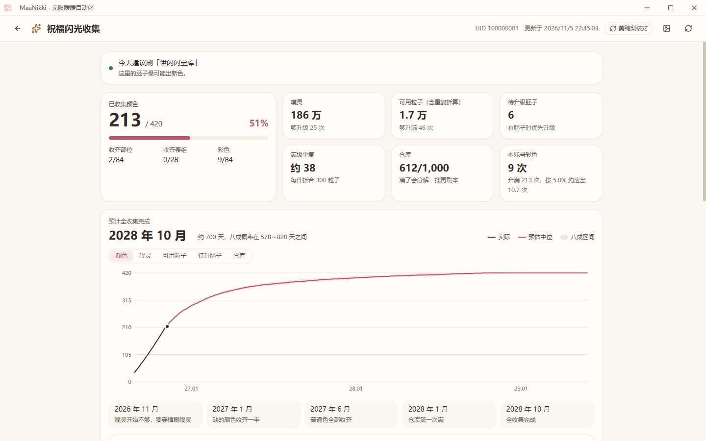

预估图可以切换颜色、噗灵、可用粒子、待升胚子和仓库，鼠标悬停时精确到日期。预估按当前存量模拟流程，彩色概率未经官方确认，只作参考；也可以在页面上调整假设，试试“如果……”。

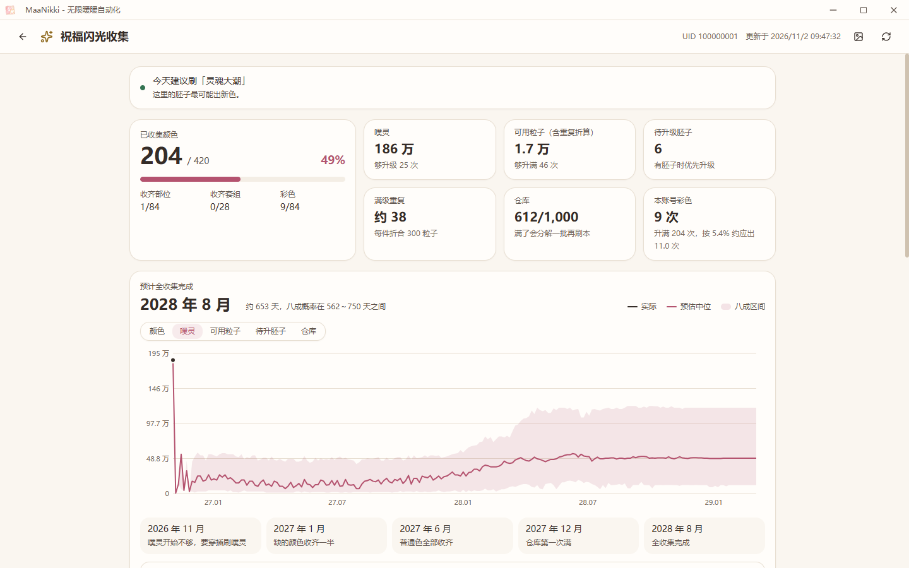

往下翻是每个副本的详情，可以搜索、筛选未收齐或只缺彩色的项目。登录美鸭梨账号后可点顶部的「美鸭梨核对」同步手账图鉴、校验并修复长期未全量扫描产生的部位漂移；顶部的图片按钮可以复制不含 UID 的分享图。

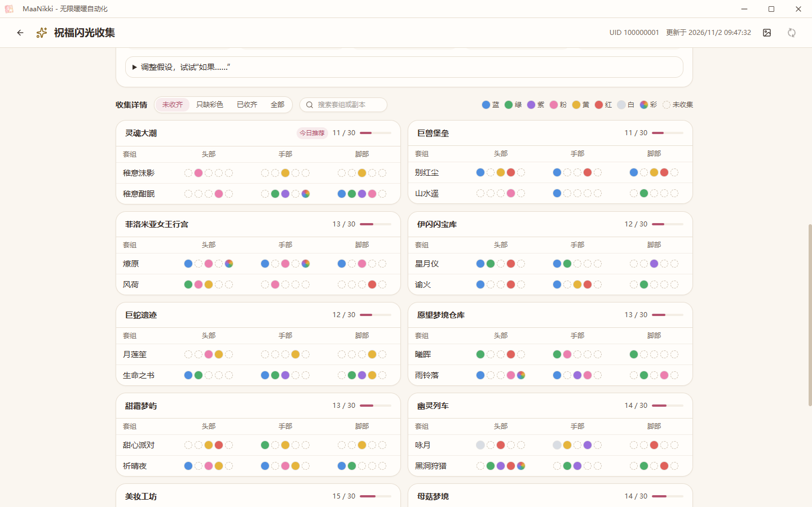

### 匿名统计

「设置 → 通用 → 帮助改进软件 → 祝福闪光统计」默认开启，用来确认彩色概率和优化推荐策略，汇总结果公开在[官网](https://maanikki.cn/stats/)。只上报闪光名称、部位、颜色、数量、刷噗灵的能量与产出、版本号，以及服务器首次发放的随机匿名 ID（在「收集进度」可查看），不含 UID 或设备信息，可随时关闭。

## 衣柜与搭配

点右侧功能区的「**衣柜与搭配**」，上方可以切换「衣柜读取」「衣柜浏览」「制衣与材料」和「搭配计算」。

### 衣柜读取

进入游戏后点「开始读取」，任务会打开「博物图鉴 → 检索」并自动筛选已获得服装，按卡片上的服装名称逐部位翻页读取，无需手动清空换衣间筛选。读取期间辅助功能自动暂停；途中停止后可以继续，再次读取时若某部位已拥有数量未变化会直接沿用已有记录。

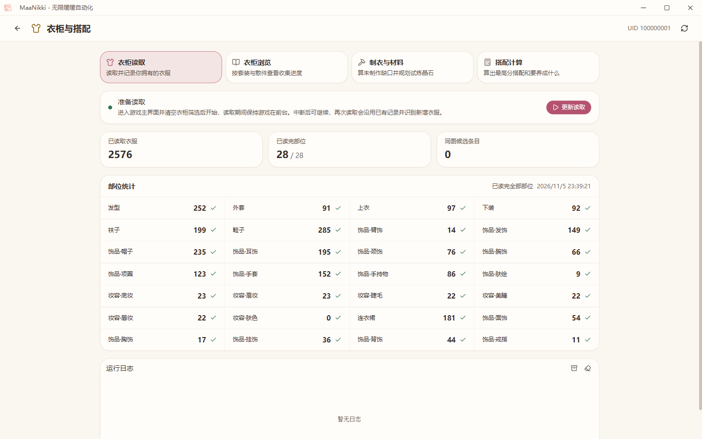

### 衣柜浏览

读取衣柜后，可以在「衣柜浏览」中按套装或散件查看收集进度：

- **按套装查看**：展示各套装的集齐进度与缺失部件，支持筛选「差 1～2 件集齐」，展开后可就地填写部件等级或生成套装分享卡。
- **按散件查看**：按部位、星级、主属性、拥有状态（包括尚未收集的大世界宝箱散件）检索全部衣服，并查看获取途径。

### 搭配计算

1. 从当期巅峰赛、往期巅峰赛、搭配赛或其他搭配中选择场次，可选择仅计算单场或整期多场次合并规划。
2. 在「无限之心加成」中按区域节点勾选或一键设为满级，填写衣服等级，并按需填写评价分数门槛。
3. 点「开始计算」，查看已知等级估分、焕新潜力搭配、先升哪件的建议和养成材料差额；也可展开任意部件临时排除重算，或点「生成分享图」搭配本地游戏相册照片生成分享卡片。
4. 在「养成材料差额」中点「设为幻境目标」，可直接将所缺材料对应的素材激化或魔物试炼设为当前配置的幻境挑战目标。

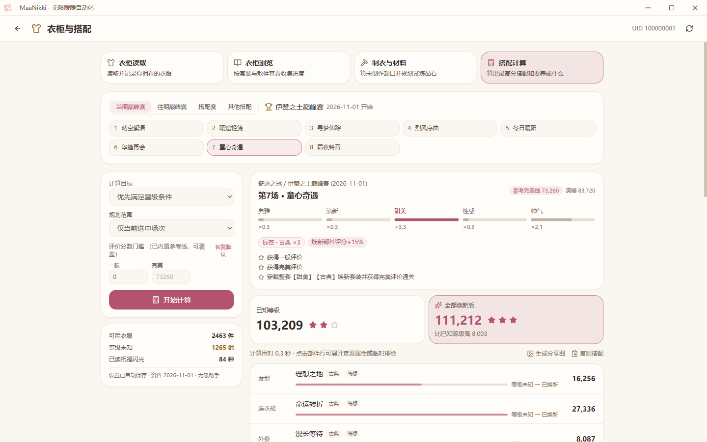

同一养成组的所有颜色共享等级，持有焕新赠送款会自动判为已焕新。等级未知的部件也参与潜力计算，材料差额要补充等级后才能算。设置按 UID 保存。

## 辅助功能

点右侧功能区的「**辅助功能**」打开设置，格子上的开关控制启停。开启后即使游戏还没启动也会等待，检测到游戏窗口后自动运行；关闭游戏后自动停止，下次启动游戏时恢复。

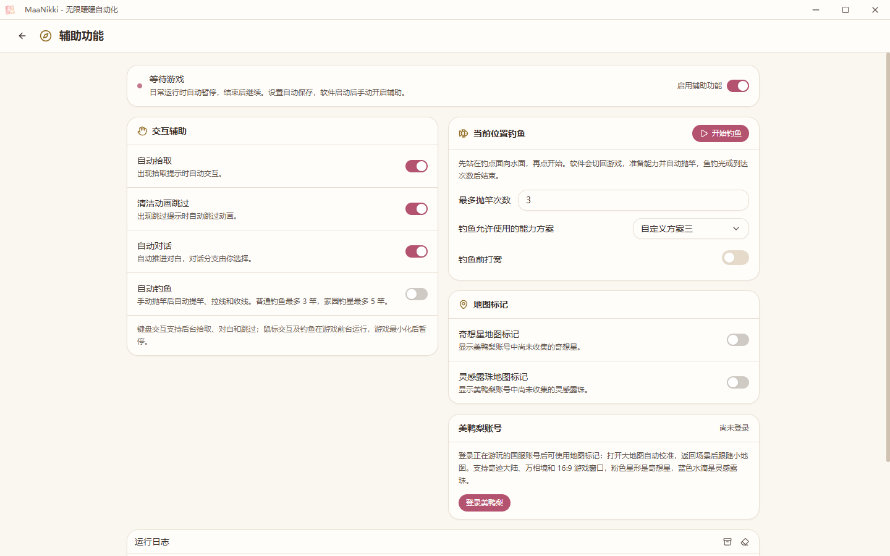

| 功能 | 使用方式 |
| --- | --- |
| 自动拾取 | 识别交互提示后拾取 |
| 自动对话 | 自动推进对白，分支由你选择 |
| 清洁动画跳过 | 手动开始清洁后，出现提示时跳过动画；部分剧情动画共用该提示 |
| 自动钓鱼 | 手动抛竿后接管提竿、拉线和收线；普通钓鱼默认最多 3 竿，家园钓星最多 5 竿 |

运行日常时辅助自动暂停，结束后恢复。交互键设为键盘按键时，拾取等辅助可以在游戏切到后台后运行；鼠标交互和自动钓鱼只在前台运行，游戏最小化时暂停。

### 当前位置钓鱼

先站在钓点面向水面，再点「开始钓鱼」。软件切回游戏，准备能力并自动抛竿，默认最多 3 次，鱼钓光后结束。「钓鱼前打窝」需要解锁万物交响能力。钓鱼期间辅助功能暂停，结束后自动恢复。

### 奇想星、灵感露珠与宝箱标记

1. 在本页登录**美鸭梨国服账号**。
2. 开启需要显示的标记（奇想星、灵感露珠、设计图宝箱、其他宝箱），再开启辅助功能开关。
3. 在游戏中打开大地图，等待自动校准；可在任意缩放比例下拖拽或缩放浏览，点击大地图上的标记即可查看美鸭梨点位教程（含具体类别、编号、获取难度、实机配图与文字说明，重叠点位可左右切换）。
4. 返回场景后，在小地图查看附近点位。

支持奇迹大陆、万相境和 16:9 游戏画面。未收集进度约每 15 秒读取一次。切出游戏、进入其他页面或定位中断时，标记暂时隐藏，恢复定位后继续显示。路线编辑器左侧工具栏也可以开启设计图与大喵宝箱图层，方便对照点位规划跑图路线。

## 路线编辑器

想让软件帮你跑一条自己的路线？点右侧功能区的「**路线编辑器**」，走一遍就能录下来。

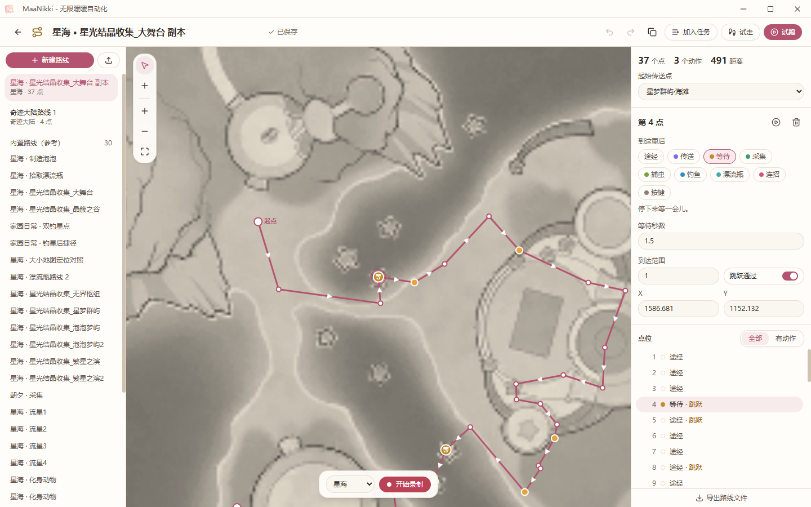

### 录制

1. 选好地图，点「**开始录制**」，软件会切到游戏。
2. 在游戏里正常走一遍。跳跃、交互、攻击、摇铃、使用能力和快捷能力键会自动记下，长按会记住按住的时长，原地连续攻击会合并成一个点。打开菜单或传送时自动暂停，传送也会被标记出来。
3. 需要在某个位置做动作时，按对应的键，听到提示音就是记好了：

| 按键 | 记录 |
| --- | --- |
| `F6` | 关键点：简化时一定保留，运行时走得更准 |
| `F7` | 采集 |
| `F8` | 等待 3 秒 |
| `F9` | 钓鱼，同时记下当前面朝的方向 |
| `F10` | 下落攻击 |

4. 回到软件点「**结束录制**」，拖动滑块调整点位疏密，再保存为路线。

录制只读取画面和按键，不会操作游戏。

### 调整

- **点位**：在地图上直接拖动。按 `A` 或左上角的 `+` 进入添加模式，点地图追加，点线段插入。选中后按 `Delete` 删除。
- **动作**：点选一个点，在右侧选择到这里后要做什么：传送、等待、采集、捕虫、钓鱼、漂流瓶、连招或按键。
- **传送**：录到传送时，要在右侧选择传送点；也可以给路线设置起始传送点。

改动会自动保存，可以用 `Ctrl+Z` 撤销。有问题的点位会在右上角列出来，点一下就能跳过去。

### 试跑和使用

- **试走**：只走路，不做动作，用来确认路线通不通。
- **试跑**：完整运行。选中某个点后可以从这里开始，不用每次从头跑。
- **加入任务**：放进当前任务列表，和日常一起运行或定时运行。

路线保存在 `config/routes/`。点左上角的「**导出**」或右上角的复制按钮就能分享给朋友，对方点「**导入**」即可。

## 共鸣记录与巨陨星

### 共鸣记录

点右侧功能区的「**共鸣记录**」。登录美鸭梨国服账号并打开开关后，每 30 分钟自动同步，托盘中继续运行；也可以点「立即同步」。

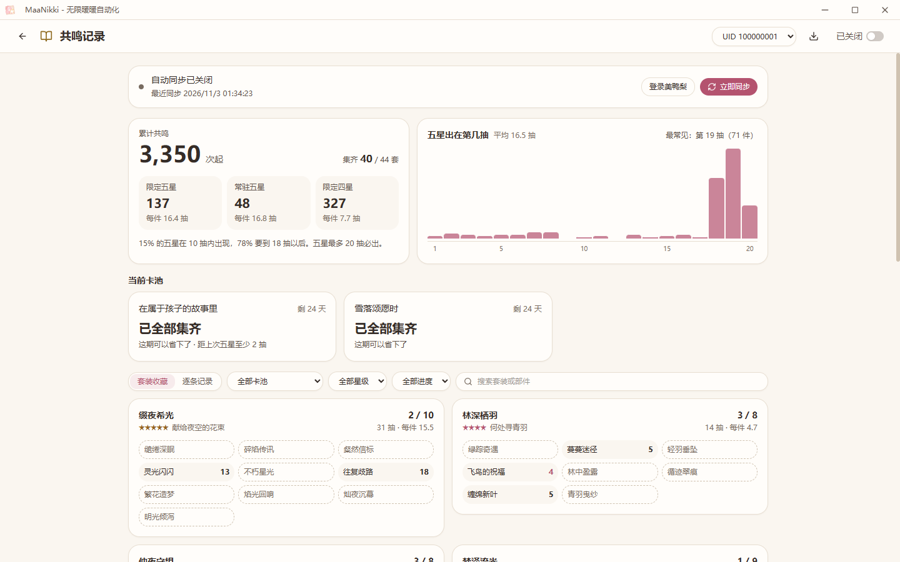

- **套装收藏**：通过美鸭梨手账展示四、五星套装的部件进度与获取数量。
- **逐条记录**：展示游戏内共鸣历史与抽取时间。

页面顶部汇总累计共鸣、平均抽数和五星分布，并显示当前卡池还差多少。支持筛选和 JSON 导出，导出的文件可用于 Gongeo 共鸣记录工具。历史范围与延迟以接口返回为准。

### 巨陨星

家园日常结束时会检查巨陨星提示，结果显示在右侧功能区，每天凌晨 4 点刷新。发现巨陨星后由你前往处理。

### 账号数据

任务从游戏左下角识别 UID，自动使用对应存档，所以切换游戏账号不用额外设置。周期任务状态、祝福闪光、衣柜和共鸣记录都保存在 `config/accounts/CN/<UID>.json`，备份或迁移时保存这个文件即可。字段说明见[开发文档](architecture.md#祝福闪光数据与诊断)。

## 设置

点右上角的齿轮打开设置。

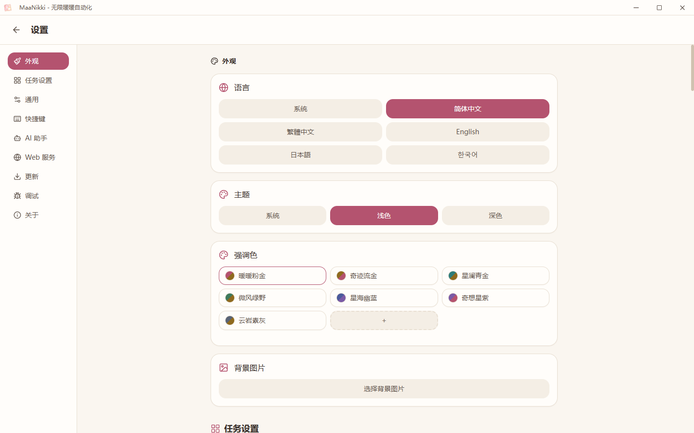

| 分类 | 可以做什么 |
| --- | --- |
| 外观 | 切换语言、浅色或深色主题、7 套强调色，设置背景图片 |
| 任务设置 | 游戏键位、游戏离开前台时的行为 |
| 通用 | 帮助改进软件、运行结果推送等 |
| 快捷键 | 录入软件快捷键 |
| AI 助手 | 生成接入 Codex、Claude Code 的命令；默认只读，写入由你决定 |
| Web 服务 | 用浏览器访问软件界面 |
| 更新 | 检查更新、填写 Mirror酱 CDK、配置网络代理 |
| 调试 | 清理日志、开发模式 |

喜欢深色的话，右上角的月亮按钮可以一键切换。

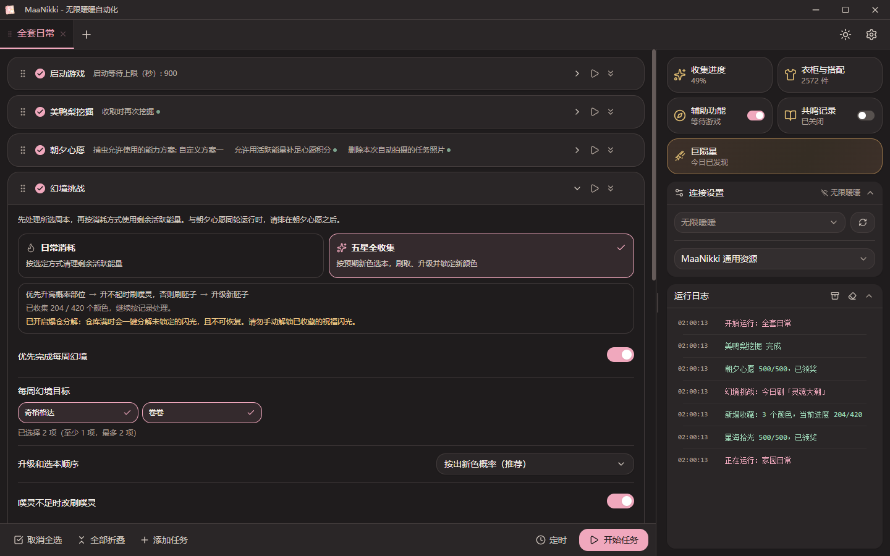

### 连接与截图

连接游戏时优先使用 FramePool 截图，初始化失败后依次尝试 DXGI 窗口截图和 ScreenDC。使用备用方式时，请保持游戏窗口完整显示；切出游戏后，拾取等辅助也会暂停。

## 更新、日志与反馈

### 软件更新

启动时及运行期间每 6 小时检查最新版本，后台下载更新包，任务空闲时安装并重启。

更新优先使用增量包，需要时改用完整包。在「设置 → 更新」填写 Mirror酱 CDK，可使用高速更新；免费线路会比较 GitHub 与 GH-Proxy 的速度，自动选择线路。

### 遇到问题

使用软件的「**导出日志**」，附上运行时间和当时的操作，发到 QQ 群 **654174255** 或 [Issue](https://github.com/architect9331/MaaNikki/issues)。导出结果是一个不超过 24.5 MB 的压缩包，优先保留最新运行的日志和失败截图。

日志面板的清空按钮只清空展示。日志文件可以在「设置 → 调试」确认清理，也可以设置保留 7／30／90 天；默认保留全部。

| 位置 | 内容 |
| --- | --- |
| `debug/messages/` | 详细任务消息 |
| `debug/on_error/` | 失败现场截图与识别摘要 |
| `logs/navigation/` | 导航、传送和路线执行记录 |
| `logs/blessing-lock/` | 仓库整理与锁定记录 |
| `logs/blessing-pursuit/` | 全收集与升级记录 |
| `logs/wardrobe/` | 衣柜读取结果与翻页记录 |

### 帮助改进软件

正式运行包默认开启「设置 → 通用 → 帮助改进软件」下的三项独立开关：错误与运行诊断（崩溃、任务统计及失败日志与遮罩 UID 的错误截图）、路线与坐标调优（跑图航点的到达偏移、脱困与采集交互统计）、祝福闪光统计（满级颜色与刷噗灵产出）；三项均可随时单独关闭，本地日志继续保存。

错误截图保留游戏画面，并遮罩左下角 UID 区域。日志正文与画面中可能包含的账号信息，在分享前请自行检查。

## 常见问题

| 情况 | 处理方式 |
| --- | --- |
| 框架加载失败 | 按提示安装 VC++ 运行库，或从「下载完整包」修复安装后重试 |
| 提示截图尺寸不符 | 将实际游戏画面调整为 16:9，核对最大化后的比例，再运行任务 |
| 全收集提示整理未完成 | 清除仓库筛选后重新运行；下次运行会自动重新整理 |
| 升级因缺噗灵结束 | 补充噗灵后继续；可将幻境挑战改为素材激化 |
| 地图标记暂时消失 | 切回游戏，打开所选地图的大地图，等待定位完成 |
| 需要调试单条路线 | 在「设置 → 调试」开启开发模式，使用「路线测试」；入口与记录见[开发文档](architecture.md#开发模式) |
