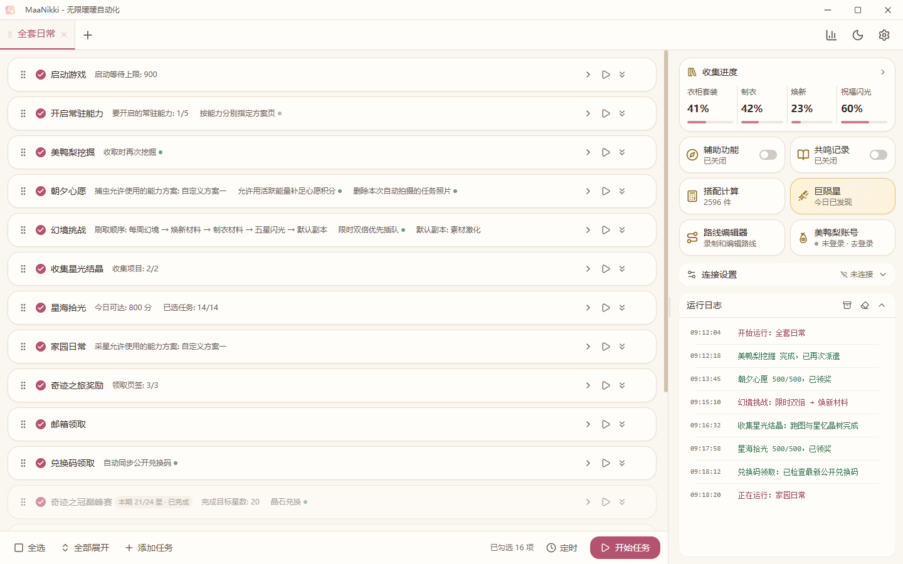
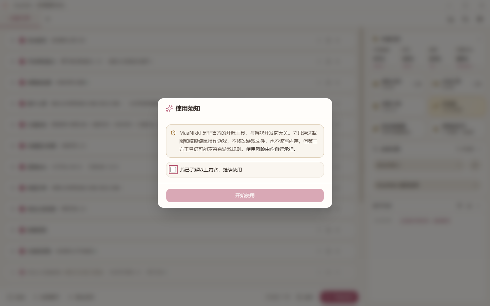
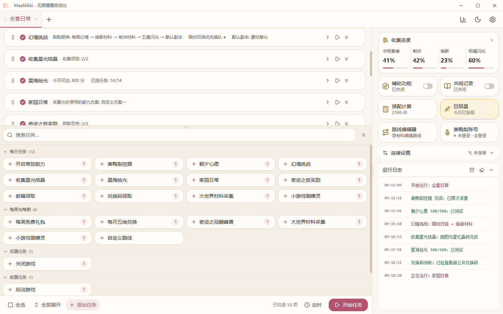
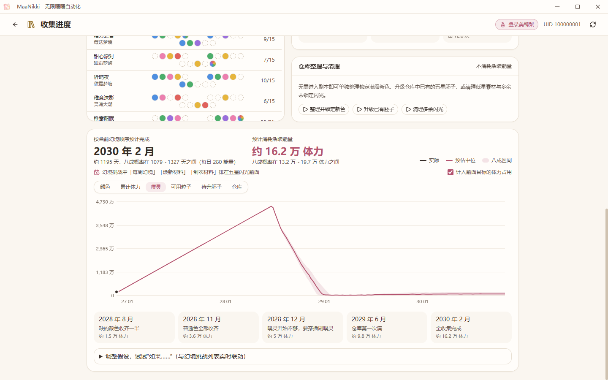
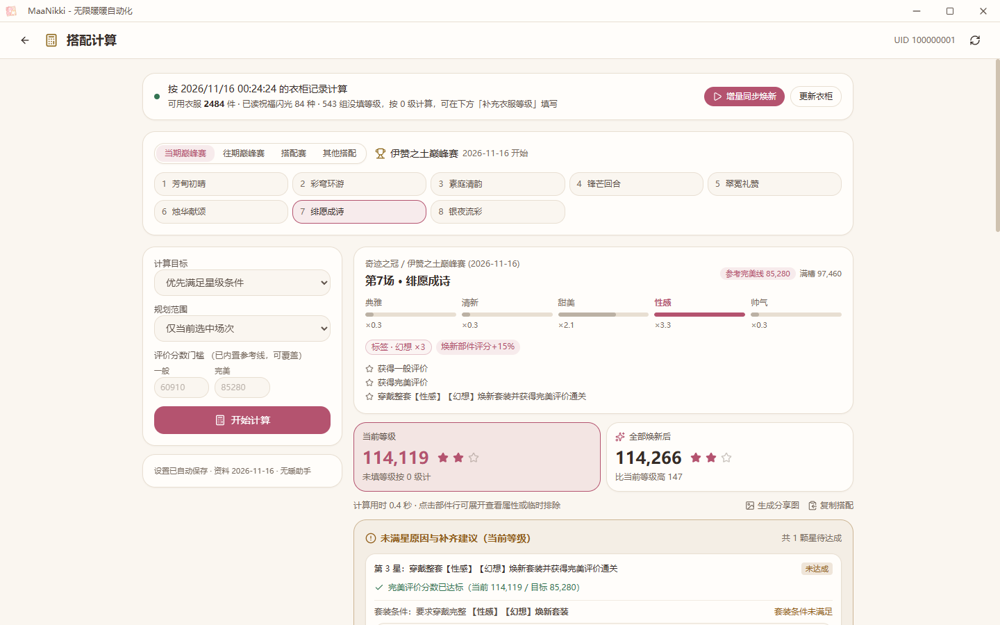
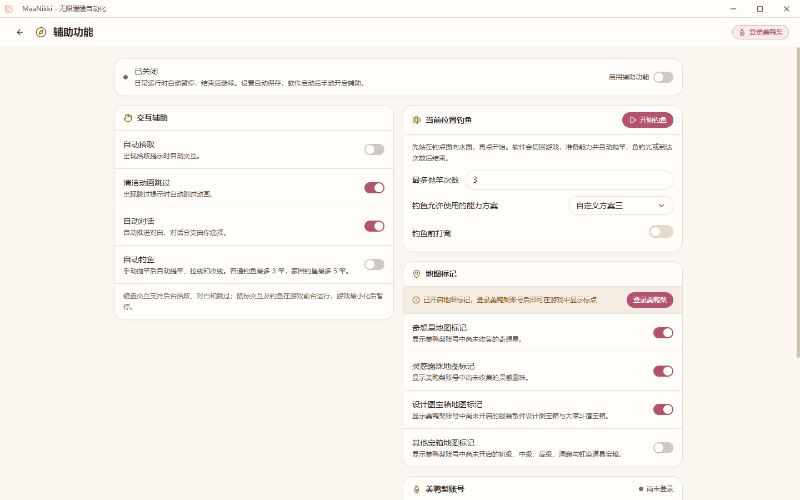
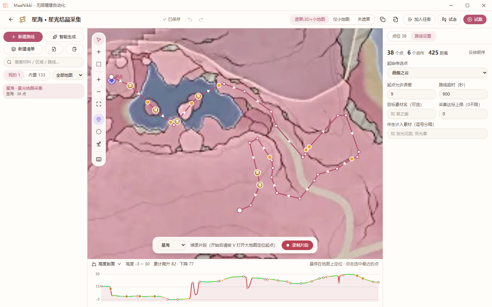
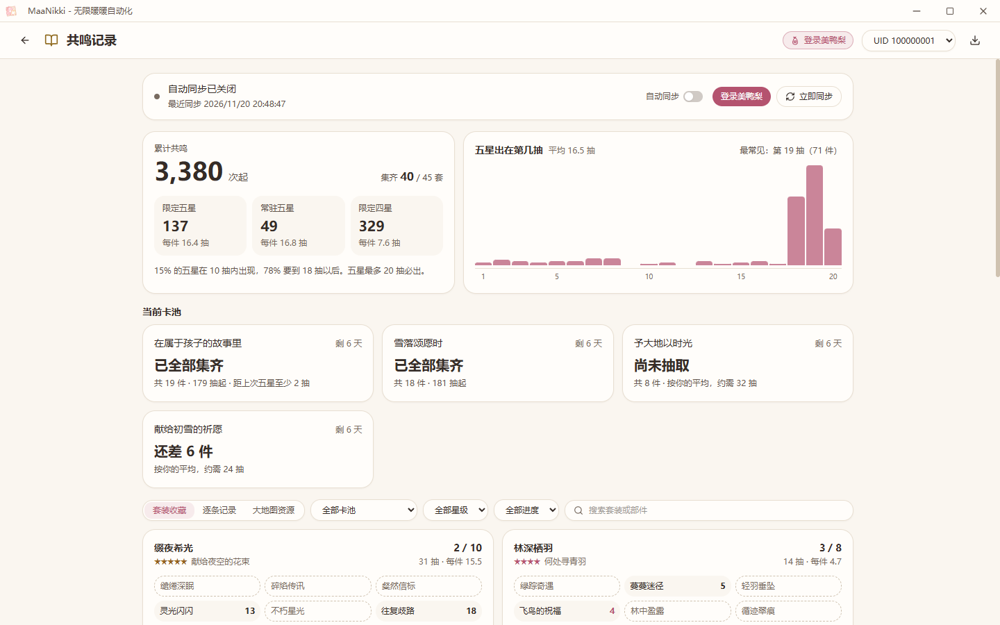
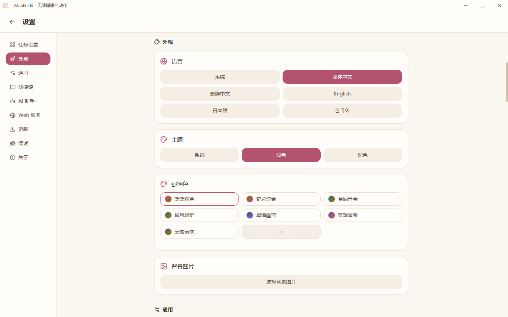
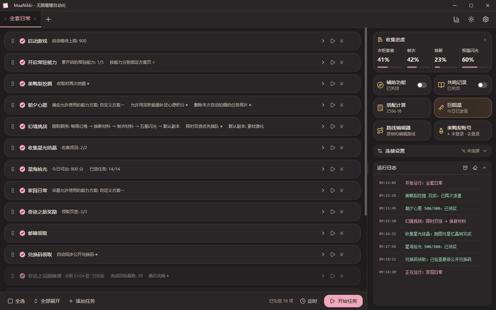

# MaaNikki 用户手册

[返回首页](../README.md) · [更新日志](../CHANGELOG.md) · [问题反馈](https://github.com/architect9331/MaaNikki/issues)

欢迎使用 MaaNikki！从日常领奖到祝福闪光追全，按自己的习惯安排任务就好。

## 目录

- [快速开始](#快速开始)
- [主界面怎么用](#主界面怎么用)
- [日常任务](#日常任务)
- [幻境挑战](#幻境挑战)
- [祝福闪光全收集](#祝福闪光全收集)
- [收集进度](#收集进度)
- [搭配计算](#搭配计算)
- [辅助功能](#辅助功能)
- [路线编辑器](#路线编辑器)
- [共鸣记录与巨陨星](#共鸣记录与巨陨星)
- [设置](#设置)
- [更新、日志与反馈](#更新日志与反馈)
- [常见问题](#常见问题)

## 快速开始

1. 从 [Releases](https://github.com/architect9331/MaaNikki/releases) 下载 **Windows x64 运行包**，完整解压到一个文件夹，启动 `MaaNikki.exe`。
2. 阅读使用须知。第一次使用时，再选择想让软件处理的任务、是否追全祝福闪光，并确认准备事项。
3. 游戏画面推荐 **1920×1080**（非 16:9 窗口默认在运行任务时自动调整并恢复）。如果改过按键，到「设置 → 任务设置 → 游戏键位」核对一下。
4. 确认相关地图、传送点、能力和关卡已经解锁，点「**开始任务**」。

MaaNikki 是非官方工具，只通过截图和模拟键鼠操作游戏，不修改游戏文件，也不读写内存，但第三方工具仍可能不符合游戏规则，使用风险由你自行承担。

> 在用 Codex 或 Claude Code？可以在「设置 → AI 助手」接入，让它们帮你完成配置，详见[接入说明](https://github.com/architect9331/MaaNikki/blob/main/ai/README.md)。

## 主界面怎么用

左边是任务列表，右边是功能区、连接设置和运行日志。

### 运行任务

勾选任务后点右下角「**开始任务**」，从上往下依次运行。每个任务右侧有三个按钮：

| 按钮 | 作用 |
| --- | --- |
| `>` | 展开任务选项 |
| `▷` | 只运行这一个任务 |
| `⌄⌄` | 从这个任务开始往下运行 |

手动开始时，软件会提醒第一次全收集前清除仓库筛选、爆仓分解、移动键重复、启动器路径失效等情况。任务失败后，日志会列出可以检查的事项。

运行时默认需保持游戏在前台，切出游戏会自动暂停并在切回后继续。在「设置 → 任务设置 → 游戏离开前台时」还可改为「回到游戏」，或选择「后台运行（WASD 后台寻路 + 瞬时借位点击）」：切出游戏后任务继续运行，仅在点击或拖曳界面时瞬时借用鼠标并立即归还，跑图按小地图视角实时闭环控制 WASD 全向行进（行进中不占用鼠标，游戏内开启或关闭镜头水平辅助均可直接使用；需使用支持后台的截图方式且不能最小化游戏；遇到摆饰调整视角、捕虫、钓鱼、净化攻击或鼠标绑定快捷键等必须使用物理鼠标的步骤，会自动抢占并持续拉回游戏前台直到该阶段结束，并在画面顶部显示切回原因，完成后自动恢复后台运行）。可在「设置 → 任务设置 → 画面状态与切窗原因提示」调整顶部状态条显示方式。

### 添加任务和多套配置

点「添加任务」可以按分类添加任务，也能加入倒计时、系统通知、自定义程序等特殊任务。拖动左侧手柄可以调整顺序。顶部的 `+` 新建配置页签，保存另一套任务组合。

默认配置「全套日常」已经排好顺序：朝夕心愿在幻境挑战之前，收集星光结晶在星海拾光之前，「启动游戏」最先执行。启动游戏可以填写官方启动器 `launcher.exe` 的路径，留空时自动查找，开启「后台运行」时也可在后台完成启动与进游戏。

### 定时执行

点「定时」设置运行时间，并保持 MaaNikki 运行。定时启动使用当前配置，游戏窗口、按键和前台要求与手动启动相同。

想在手机上收到结果，可以在「设置 → 通用 → 运行结果推送」填写 Server酱、Bark 等服务的地址。

## 日常任务

| 任务 | 会做什么 | 需要留意 |
| --- | --- | --- |
| 美鸭梨挖掘 | 领取奖励，默认沿用当前目标再次派遣 | 关闭「收取时再次挖掘」后只领奖 |
| 朝夕心愿 | 完成采集、捕虫、打怪、拍照等已适配项目，补足 **500 分**并领奖 | 小游戏和制作服装类心愿请手动完成 |
| 星海拾光 | 按勾选的子任务补足 **500 分**并领奖 | 展开选项可查看 8 天轮换表 |
| 收集星光结晶 | 可选跑图收集、星忆晶树，支持两项都选 | 提前解锁所需地图与无界枢纽 |
| 家园日常 | 钓星、下落攻击、点赞与领奖，并检查巨陨星提示 | 可设置采星能力方案 |
| 奇迹之旅奖励 | 分别领取旅行任务、旅行秘宝和乐园构想 | 三项可单独勾选 |
| 邮箱领取 | 领取邮件中全部可领取的附件 | 默认排在奇迹之旅之后 |
| 开启常驻能力 | 按多选清单切换并开启姜饼人随行、化万相拾取、栖林沐光、金鹰之眼隐匿与视野 | 可为各能力单独指定方案页，已开启项自动跳过 |
| 大世界材料采集 | 使用姜饼人范围拾取能力，按顺序跑完所选采集路线 | 默认出发前自动召唤小姜饼人随行 |
| 小游戏刷噗灵 | 前往花愿镇「穿梭大冒险」自动连续挑战刷取噗灵 | 到达 NPC 后默认支持后台继续，每日大世界上限 16 万 |

下面几项会按周期自动跳过，保留勾选即可。周期都以**北京时间凌晨 4 点**切换。

| 任务 | 会做什么 | 刷新时间 |
| --- | --- | --- |
| 每周免费礼包 | 领取虹迹赠礼、芳馨赠礼、星实置业之礼 | 每周一 |
| 每月五抽兑换 | 用静谧水滴兑换启示水晶、共鸣水晶各 5 个 | 每月 1 日 |
| 奇迹之冠巅峰赛 | 用游戏推荐搭配挑战已解锁关卡，默认目标 12 星，可设为 1～24 星 | 每月 1 日、16 日 |

巅峰赛的「晶石兑换」默认关闭，开启后按清单顺序兑换，商品名用逗号分隔。

### 小细节

**朝夕心愿**

- 「允许用活跃能量补足心愿积分」默认开启。需要幻境补分时，与限时双倍共用幻境挑战中的「限时双倍与选关策略」：有多张耗能心愿时优先挑当前有双倍或符合「刷取顺序」缺口的心愿，按最少量挑战一次补齐当前所需材料或缺色闪光；若已无缺口或策略设为「使用默认设置」，则改刷「默认副本」设置中对应的默认关卡凑满 500 分。
- 升级祝福闪光心愿优先选择五星，其次四星、三星，成功升级一次即可。缺少噗灵或素材时结束升级。
- 任务照片默认保留，可在选项中开启自动删除。

**星海拾光**

已适配 15 项子任务：

| 类型 | 项目 |
| --- | --- |
| 互动 | 动物互动 3 次、不同动物互动、聚会聊天 |
| 拍照 | 拍照、星愿瓶合影、星芒之翼合影 |
| 操作 | 摇铃、放置摆饰、星绘图册点赞、更改音乐、召唤流星 |
| 收集 | 投递信笺、制造泡泡、收集星光结晶、漂流瓶查看 |

轮换表里缺分的组合会标黄，并显示需要开启或手动完成的项目。椰果采摘与拍照、星愿碎片投递与拍照、泡泡合影、海螺活动及跳上泡泡请手动完成。聚会聊天会向已识别的聚会频道发送一次配置中的消息。

**收集星光结晶**

在「收集项目」中勾选「跑图收集」「星忆晶树」，可以单选，也可以两项都选；都选时先跑图再收晶树。已有配置默认保留跑图收集。

- **跑图收集**：摇铃后定位当日结晶并选择路线。卡住超过 **30 秒**时，传送回起点重试，最多额外重试 **3 次**；结束后显示星之魄、星光结晶、星光微尘的今日累计和本趟新增。
- **星忆晶树**：先收取树下已落地的结晶；还有存储时，长按摇铃让下一批落地，再绕树收集，每次最多落地 **40 个**。每轮核对地图详情中的存储量与待收获量，直到两项归零；数量读不清或收集后没有减少时会停止并提示。

**能力方案**

捕虫、钓鱼和家园钓星可以选择允许使用的能力方案。方案改过名也可以用，按游戏列表从上到下对应方案一、二、三，名称不要重复。跑图跳跃与滑翔已适配纸鹤、凤凰、魔女等漂浮套装；若使用精灵漂浮套跑跨河或长滑翔路线，建议在游戏能力设置中将漂浮触发方式设为常驻漂浮以免单次振翅后提前下落。

**小游戏刷噗灵**

任务选项中默认开启「挑战阶段后台运行」：若需从「心愿花街」跑图前往 NPC，普通模式下跑图仍在前台完成，到达 NPC 并进入对话、挑战与结算后切出游戏不会自动暂停或强行切回前台（需保持游戏窗口不最小化）；若在「设置 → 任务设置 → 游戏离开前台时」选择「后台运行」，前往 NPC 的跑图也会一并在后台通过 WASD 全向寻路完成。如需全程保持前台，可在任务选项中关闭该开关。

## 幻境挑战

在「刷取顺序」统一设置每周幻境、焕新材料、制衣材料、五星闪光与**默认副本**，分别开关并拖动调整先后；列表右侧实时显示各项的预期消耗体力、预计天数与顺位完成时间，底部可调整每日活跃能量基准并展开队列总趋势。软件会先处理排在前面的目标，完成后继续下一项：

- **每周幻境**：可展开「关卡」选择奇格格达、卷卷；轮到时使用本周剩余次数，各挑战一次。想优先完成周本，请将它排在最前。
- **焕新材料**：按当前衣柜与已填等级、手动材料目标或搭配计算导入的优先部件补齐材料；存在多类缺口时优先按体力缺口大小补足所需泡泡与纯真丝线，最后再补噗灵，并在卡片下方显示当前阶段与下一步将刷取的具体材料。
- **制衣材料**：根据未制作设计图的全收集、战力或自选计划按缺口刷取魔物试炼晶石（卡片下方同步显示下轮优先刷取的晶石）；参与激化双倍时，按同样的缺口优先级顺带补足制衣所需的纯真丝线与噗灵，大世界材料请按清单自行准备。
- **五星闪光**：按全收集、战力或自选套组选本挑战，收齐所选范围后会跳过；展开「设置」可切换全流程托管或只刷胚子，并配置保留噗灵数、爆仓自动分解与仓库整理方式（急需的材料建议排在闪光之前）。
- **默认副本**：上述目标都已完成或未开启时使用，可在这一行展开「设置」统一配置默认副本类型、素材激化／祝福闪光／魔物试炼三个幻境的默认关卡（动态标签会标注当前职责），以及素材激化时消耗的收集材料。

首次执行焕新或制衣材料前若尚无衣柜记录、或美鸭梨服装数相比上次已发生变化，软件会先通过「服装焕新」快速增量同步新增服装与等级，并每天首次打开背包核对库存。

列表下方的「**限时双倍与选关策略**」控制活动优先插队与朝夕心愿补分：开启「限时双倍优先插队」后，检测到超级激化、灵感迸发、魔物试炼、深度突破或回归双倍时先于刷取顺序插队挑战（各类活动可单独取消勾选，深度突破可指定优先奇格格达或卷卷）；下方的选关策略同时用于双倍插队与朝夕心愿补分，素材激化、祝福闪光与魔物试炼均支持选择「智能选择（根据收集计划）」或「使用默认设置」，已开启收集计划且无缺口或已收齐时双倍会自动跳过、朝夕心愿补分改刷对应默认关卡；未开启「焕新材料」与「制衣材料」时，激化与魔物试炼会自动回退为使用默认设置。

原独立任务「焕新材料筹备」已合并为「焕新材料」。已有配置同时包含这两项任务且原筹备任务已开启时，焕新材料会排在其他材料目标前面；原每周幻境的开关与优先顺序会保留。如果没有幻境挑战任务，请先手动添加。

| 消耗方式 | 设置内容 |
| --- | --- |
| 素材激化 | 选择默认奖励，按数量最多或首选／备选顺序使用材料 |
| 普通祝福闪光 | 选择默认关卡，快速挑战获取胚子 |
| 魔物试炼 | 按所需材料选择默认关卡 |

请提前解锁对应关卡、困难难度和快速挑战。

## 祝福闪光全收集

### 第一次使用

1. 清除游戏祝福闪光仓库的筛选。
2. 提前锁定想保留的物品。
3. 在「**幻境挑战 → 刷取顺序**」开启「**五星闪光**」，运行日常或幻境挑战。
4. 第一次运行会先整理全部祝福闪光，再选择副本刷取并升级。

### 每次运行会做什么

1. 刷取顺序轮到五星闪光时，读取已保存的进度。
2. 先升级仓库里已有的胚子。噗灵不够时，当天活跃能量全部刷噗灵，刷完接着升。
3. 胚子都升完后，选择最可能出新色的副本，用剩余活跃能量刷取一批。
4. 分解四星及以下未锁定闪光，再读取新增的胚子。
5. 按出新色概率从高到低升级。满级后识别颜色，锁定新颜色，重复颜色留作后续素材。
6. 保存结果，日志显示本轮新增颜色和当前进度。

中途被打断可以直接重跑，软件会先恢复相关部位的进度。缺噗灵或材料时会保存当前对象并正常结束，下次优先继续。

### 为什么推荐这样刷

每次升满要 360 闪光粒子和 72000 噗灵。粒子用完后，一键放入会把未锁定的胚子和满级重复项当作材料，所以重复项不必为了粒子分解。真正要靠时间积累的是粒子和噗灵，胚子相对容易获得。

- **按出新色概率升级与选本**：每次花费相同，缺色多的部位更容易出新色，只缺彩色的部位排到最后。
- **全流程托管与只刷胚子**：默认「全流程托管」负责整理、刷本、分解、升级并锁定满级新颜色，可设置「保留噗灵数」保证升级后剩余噗灵不低于设定值；若想自己手动升级与管理仓库，可切为「只刷胚子」，软件只读取颜色与仓库现有胚子数并按边际出新色期望自动选本刷取。
- **噗灵不足时改刷噗灵**：胚子升不起时继续刷本只是囤货，所以按天二选一。需要自己准备素材激化的材料，也可以在选项中关闭。
- **彩色概率未经官方公布**：软件内的概率来自社区统计，只决定先后顺序，不要求完全准确。

### 请注意这两点

**素材使用**：升级采用游戏「五星及以下素材」一键放入，会消耗未锁定的五星胚子；刷取后会分解四星及以下未锁定闪光。请不要手动解锁已收藏的祝福闪光。

**爆仓时分解重复祝福闪光**默认开启，分解后无法恢复。仓库满 1000 格时游戏无法继续刷本，开启后，仓库满且没有待升级胚子时，一键分解一批（最多 100 件）。一键放入会选中所有未锁定的闪光，包括三星、四星，但不会选中已锁定项。关闭时，仓库满了当天不刷本，日志会提示手动分解。

### 什么时候重新整理

平时不用管，手动获得的新胚子也会自动纳入处理。手动大量升级、解锁或分解后，把「**仓库整理**」改为每次运行前整理，运行一次后改回自动。

整理未完成时，本轮改刷「**默认副本**」，任务显示为未完成，下次运行重新整理。出现图鉴外闪光提示时，先手动锁定要保留的闪光，再整理一次。

追全范围是本地图鉴中的**五星满级颜色**，新套组随图鉴更新。在「收集进度 → 祝福闪光」可切换全收集、战力（每套各部位集齐任意 1 个满级色即停，同时继续锁定顺带获得的满级新异色）或勾选自选套组；自选只影响刷本范围，仓库里其他套组的已有胚子仍可能升级。已收齐所选范围时，幻境挑战会跳过闪光目标，继续处理后面的目标或默认副本。

## 收集进度

点右侧功能区的「**收集进度**」，上方可以切换「我的衣柜」「制衣」「焕新」「祝福闪光」与「背包库存」。「制衣」「焕新」和「祝福闪光」统一提供全收集／战力／自选、目标清单、下轮刷取顺位与进度，右侧材料清单同步标注「下轮优先」「顺位 #2/#3」等优先级；点击「刷取设置」跳转到幻境挑战，统一调整开关、顺序和默认副本，修改收集计划不会自动开启刷取。

「制衣」按未制作的设计图备料，全收集与战力模式下均支持先做「仅成套」再切到「全部设计图」并实时预估晶石天数；「焕新」按已有衣服的当前等级备料，支持「增量同步」与「完整读取」同步各部位等级与焕新状态，全收集与战力模式均可按「仅五星」「5★ + 4★套装」「四星及以上」「全部星级」四档阶段逐步推进（并可用「搭配计算」导入的优先目标直接穿透阶段提前筹备）；「祝福闪光」页还提供不消耗体力的「整理并锁定新色」「升级已有胚子」「清理多余闪光」独立入口，方便随时整理仓库；在清单右上或「背包库存」页点「读取背包」即可全面读取材料页、养成材料页全部物品及噗灵数量（含大世界采集物与种子、心得等库存）。

「我的衣柜」顶部进度按本地资料中已集齐的套装统计，同一计分款的不同颜色合并判断；散件、妆容及资料尚未收录的新内容不计入套装总数，因此不代表全衣柜或全颜色收集率。

### 收集进度与趋势预估

「制衣」「焕新」与「祝福闪光」三页统一提供预计完成时间、预计消耗活跃能量与交互式趋势图，并共用「调整假设，试试“如果……”」里的每日活跃能量与日常噗灵收入设置（修改后与幻境挑战的刷取顺序列表实时联动）。

「祝福闪光」页还可查看已收集颜色、所选套组的推荐副本与噗灵、粒子存量；预估图支持切换颜色、累计体力、噗灵、可用粒子、待升胚子和仓库，彩色概率未经官方确认，只作参考。套组列表支持搜索、筛选未收齐或只缺彩色的项目，并在自选模式下按勾选范围独立预估。登录美鸭梨账号后可点顶部的「美鸭梨核对」同步手账图鉴、校验并修复长期未全量扫描产生的部位漂移；「分享图」按钮可以复制不含 UID 的图片。

### 匿名统计

「设置 → 通用 → 帮助改进软件 → 祝福闪光统计」默认开启，用来确认彩色概率和优化推荐策略，汇总结果公开在[官网](https://maanikki.cn/stats/)。只上报闪光名称、部位、颜色、数量、刷噗灵的能量与产出、版本号，以及服务器首次发放的随机匿名 ID（在「收集进度」可查看），不含 UID 或设备信息，可随时关闭。

### 我的衣柜

在「收集进度 → 我的衣柜」中读取和浏览已拥有服装。

推荐直接从「服装焕新」读取：一次即可同步除妆容外的服装拥有情况与全部当前等级，建立基准后可用「快速增量同步」按获得时间仅读取最近新获得的衣服与升级改动；如需补全妆容部件及同款进化染色数量，可再点一次「博物图鉴校准」。读取期间辅助功能自动暂停。

读取衣柜后，可以在同一页按套装或散件查看收集进度：

- **按套装查看**：展示各套装的集齐进度与缺失部件，支持筛选「差 1～2 件集齐」，展开后可就地填写部件等级或生成套装分享卡。
- **按散件查看**：按部位、星级、主属性、拥有状态（包括尚未收集的大世界宝箱散件）检索全部衣服，并查看获取途径。

## 搭配计算

点右侧功能区的「**搭配计算**」，按已读衣柜规划比赛搭配；需要更新衣柜时可跳转到「收集进度 → 我的衣柜」。

1. 从当期巅峰赛、往期巅峰赛、搭配赛或其他搭配中选择场次，可选择仅计算单场或整期多场次合并规划。
2. 在「无限之心加成」中按区域节点勾选或一键设为满级；可点「读取焕新」自动从游戏同步衣服等级与焕新状态，或按需补充实际等级与覆盖评价分数门槛。
3. 点「开始计算」，查看当前等级估分、全部焕新后潜力搭配与材料差额。多场次选择「优先满足星级条件」时，会合并各场满星需要的升级，列出目标等级与对应场次；无法满星的场次可点开查看缺失条件。也可展开部件临时排除重算，或点「生成分享图」制作分享卡片。
4. 在「养成材料差额」中点「设为优先筹备目标」，可将所缺升级部件绑定到焕新计划最前面；再到「幻境挑战 → 刷取顺序」开启「焕新材料」即可优先备料，部件升到对应等级后会自动消账并继续其余目标。

同一养成组的所有颜色共享等级：持有焕新赠送款会自动判为已焕新，其余未填写等级的衣服默认按最低等级（0 级）参与搭配与材料差额计算；若游戏内已强化，补充实际等级后可扣减对应材料消耗。设置按 UID 保存。

## 辅助功能

点右侧功能区的「**辅助功能**」打开设置，格子上的开关控制启停。开启后即使游戏还没启动也会等待，检测到游戏窗口后自动运行；关闭游戏后自动停止，下次启动游戏时恢复。

| 功能 | 使用方式 |
| --- | --- |
| 自动拾取 | 识别交互提示后拾取 |
| 自动对话 | 自动推进对白，分支由你选择 |
| 清洁动画跳过 | 手动开始清洁后，出现提示时跳过动画；部分剧情动画共用该提示 |
| 自动钓鱼 | 手动抛竿后接管提竿、拉线和收线；普通钓鱼默认最多 3 竿，家园钓星最多 5 竿 |

运行日常时辅助自动暂停，结束后恢复。交互键设为键盘按键时，拾取等辅助可以在游戏切到后台后运行；鼠标交互和自动钓鱼只在前台运行，游戏最小化时暂停。

### 当前位置钓鱼

先站在钓点面向水面，再点「开始钓鱼」。软件切回游戏，准备能力并自动抛竿，默认最多 3 次，鱼钓光后结束。「钓鱼前打窝」需要解锁万物交响能力。钓鱼期间辅助功能暂停，结束后自动恢复。

### 奇想星、灵感露珠与宝箱标记

1. 在本页登录**美鸭梨国服账号**。
2. 开启需要显示的标记（奇想星、灵感露珠、设计图宝箱、其他宝箱），再开启辅助功能开关。
3. 在游戏中打开大地图，等待自动校准；可在任意缩放比例下拖拽或缩放浏览，点击大地图上的标记即可查看美鸭梨点位教程（含具体类别、编号、获取难度、实机配图与文字说明，重叠点位可左右切换）。
4. 返回场景后，在小地图及外围同心扩展圈内查看附近点位；大圈以外一定范围内的点位会在大圈边缘以方向箭头标出，并按距离由近及远逐级缩小淡出。

支持奇迹大陆、万相境、丹青屿、花焰群岛、无忧岛和 16:9 游戏画面。未收集进度约每 15 秒读取一次。切出游戏、进入其他页面或定位中断时，标记暂时隐藏，恢复定位后继续显示。

## 路线编辑器

想让软件帮你跑一条自己的重复刷取或日常路线？点右侧功能区的「**路线编辑器**」，走一遍就能录下来。

### 录制

1. 选好地图，点「**开始录制**」，软件会切到游戏，并在小地图下方实时显示录制进度与快捷键提示。
2. 在游戏里正常走一遍。跳跃、交互、净化攻击（自动记录当前攻击朝向）、摇铃、使用能力和快捷能力键会自动记下，长按会记住按住的时长，原地连续攻击会合并成一个点。打开菜单或传送时自动暂停，中途传送及起点附近的流转之柱会自动匹配并填入对应传送点。
3. 需要在某个位置做动作时，按对应的键，听到提示音就是记好了：

| 按键 | 记录 |
| --- | --- |
| `F6` | 关键点：简化时一定保留，运行时走得更准 |
| `F7` | 采集 |
| `F8` | 等待 3 秒 |
| `F9` | 钓鱼，同时记下当前面朝的方向 |
| `F10` | 下落攻击 |

4. 回到软件点「**结束录制**」，拖动滑块调整点位疏密，可保存为新路线、接到末尾、插入到当前选中点后，或直接替换框选的局部点位。

录制只读取画面和按键，不会操作游戏。

### 调整

- **点位与批量编辑**：在地图上直接拖动。按 `A` 进入添加模式（点地图追加、点线段插入），按 `B` 或按住 `Shift` 框选多个点位可整体拖动、批量修改到达范围、批量设置跳跃或删除，也支持一键反转点位顺序。
- **动作与朝向**：点选一个点，在右侧选择到这里后要做什么：传送、等待、采集、捕虫、钓鱼、漂流瓶、连招或按键。钓鱼与左键净化攻击（连招或按键）可在地图上直接拖动朝向箭头或输入角度，下落攻击无需设置朝向。
- **流转之柱与路线参数**：地图默认显示全部流转之柱传送点（按区域分组），点击地图上的流转之柱即可直接设为起始传送点或插入传送动作；展开「路线参数与采集计数」可配置起点允许误差、路线超时、目标素材名、伴生计入素材与单轮采集上限。
- **3D 地形视图与智能生成**：顶栏可随时切换「2D 平面」与「3D 地形」视图，支持旋转、平移与缩放查看地形起伏、海拔等高线、陡坡与水体诊断、15 米姜饼人光环及三维收集物点位；点左侧「**3D 智能生成姜饼人路线**」可任选目标材料或区域大丰收模式，按需实时生成路线并在 3D 视口预览检查、一键试跑或存为清单加入任务。

改动会自动保存，可以用 `Ctrl+Z` 撤销。有问题的点位会在右上角列出来，点一下就能跳过去。

### 试跑、路线遮罩与路线清单

- **3D 地面与小地图路线遮罩**：无论是在编辑器中试走／试跑，还是执行各类日常跑图任务，游戏内默认同时叠加 3D 地面流光引导带（含目标点全息信标与转向提示）和左上角小地图路线轨迹；可在编辑器顶栏、任务选项或「设置 → 任务设置」中随时切换为「仅左上角小地图遮罩」或「关闭遮罩」。
- **试走与试跑诊断**：支持从任意选中点开始「试走」（只移动）或「试跑」（含动作），编辑器画布会实时跟随角色与当前目标点；试跑结束后自动汇总折返、脱困与漏采点位并在地图上标出实际停步偏移，支持「一键应用微调建议」。
- **路线清单与大世界材料采集**：点左上角「**新建清单**」可将多条路线按顺序串联为一个组合；也可以在主界面添加「**大世界材料采集**」任务，多选勾选内置姜饼人大丰收／分类与稀有综合路线、推荐合集或自建路线并调整顺序串联运行（需要专项单材料时可在路线编辑器内「3D 智能生成」实时构建），驻留期间会根据画面左侧材料提示自动判断姜饼人是否拾取完毕。

路线与清单保存在 `config/routes/`。点左上角的「**导出为文件**」或右上角的复制按钮就能分享给朋友，对方点「**导入**」或「**粘贴**」即可一键载入。

## 共鸣记录与巨陨星

### 共鸣记录

点右侧功能区的「**共鸣记录**」。登录美鸭梨国服账号并打开开关后，每 30 分钟自动同步，托盘中继续运行；也可以点「立即同步」。

- **套装收藏**：通过美鸭梨手账展示四、五星套装的部件进度与获取数量。
- **逐条记录**：展示游戏内共鸣历史与抽取时间。

页面顶部汇总累计共鸣、平均抽数和五星分布，并显示当前卡池还差多少。支持筛选和 JSON 导出，导出的文件可用于 Gongeo 共鸣记录工具。历史范围与延迟以接口返回为准。

### 巨陨星

家园日常结束时会检查巨陨星提示，结果显示在右侧功能区，每天凌晨 4 点刷新。发现巨陨星后由你前往处理。

### 账号数据

任务从游戏左下角识别 UID，自动使用对应存档，所以切换游戏账号不用额外设置。周期任务状态、祝福闪光、衣柜和共鸣记录都保存在 `config/accounts/CN/<UID>.json`，备份或迁移时保存这个文件即可。字段说明见[开发文档](architecture.md#祝福闪光数据与诊断)。

## 设置

点右上角的齿轮打开设置。

| 分类 | 可以做什么 |
| --- | --- |
| 外观 | 切换语言、浅色或深色主题、7 套强调色，设置背景图片 |
| 任务设置 | 游戏键位、自动调整游戏分辨率、游戏离开前台时的行为、跑图路径遮罩、画面状态与切窗原因提示 |
| 通用 | 帮助改进软件、运行结果推送等 |
| 快捷键 | 录入软件快捷键 |
| AI 助手 | 生成接入 Codex、Claude Code 的命令；默认只读，写入由你决定 |
| Web 服务 | 用浏览器访问软件界面 |
| 更新 | 检查更新、填写 Mirror酱 CDK、配置网络代理 |
| 调试 | 空间占用明细、清理日志与缓存、保留期限、开发模式 |

喜欢深色的话，右上角的月亮按钮可以一键切换；旁边的统计图标（或「设置 → 通用 → MAA 运行任务统计与纪念」）可以查看累计节省的时间、各任务执行次数排行与收集里程碑。

### 连接与截图

连接游戏时优先使用 FramePool 截图，初始化失败后依次尝试 DXGI 窗口截图和 ScreenDC。使用备用方式时，请保持游戏窗口完整显示；切出游戏后，拾取等辅助也会暂停。

## 更新、日志与反馈

### 软件更新

启动时及运行期间每 6 小时检查最新版本，后台下载更新包，任务空闲时安装并重启。

更新优先使用增量包，需要时改用完整包。在「设置 → 更新」填写 Mirror酱 CDK，可使用高速更新；免费线路会比较 GitHub 与 GH-Proxy 的速度，自动选择线路。

### 遇到问题

使用软件的「**导出日志**」，附上运行时间和当时的操作，发到 QQ 群 **654174255** 或 [Issue](https://github.com/architect9331/MaaNikki/issues)。导出结果是一个不超过 24.5 MB 的压缩包，优先保留最新运行的日志和失败截图。

日志面板的清空按钮只清空展示。日志文件与临时缓存可在「设置 → 调试」查看空间占用并确认清理（会自动保留活跃日志、窗口状态和未完成恢复目录），也可设置保留 7／30／90 天或全部（新配置默认 30 天），后台也会自动将历史备份和任务记录控制在安全容量内。

| 位置 | 内容 |
| --- | --- |
| `debug/messages/` | 详细任务消息 |
| `debug/on_error/` | 失败现场截图与识别摘要 |
| `logs/navigation/` | 导航、传送和路线执行记录 |
| `logs/blessing-lock/` | 仓库整理与锁定记录 |
| `logs/blessing-pursuit/` | 全收集与升级记录 |
| `logs/wardrobe/` | 衣柜读取结果与翻页记录 |

### 帮助改进软件

正式运行包默认开启「设置 → 通用 → 帮助改进软件」下的四项独立开关：错误与运行诊断（崩溃、任务统计及失败日志与遮罩 UID 的错误截图）、路线与坐标调优（跑图航点的到达偏移、脱困与采集交互统计）、祝福闪光统计（满级颜色与刷噗灵产出）、任务偏好与挖掘统计（日常任务启用分布、幻境挑战选择与美鸭梨挖掘目标，用于优化默认任务选择与推荐）；四项均可随时单独关闭，本地日志继续保存。

错误截图保留游戏画面，并遮罩左下角 UID 区域。截图发送至项目维护者的专用诊断存储，最多保留 30 天，仅维护者登录后可下载；关闭「错误与运行诊断」后停止上传。日志正文与画面中可能包含的账号信息，在分享前请自行检查。

## 常见问题

| 情况 | 处理方式 |
| --- | --- |
| 框架加载失败 | 按提示安装 VC++ 运行库，或从「下载完整包」修复安装后重试 |
| 提示截图尺寸不符 | 确认「设置 → 任务设置 → 运行行为 → 自动调整游戏分辨率」已开启且游戏未处于独占全屏，或在游戏设置中改用 16:9 无边框／窗口分辨率；若开启超分辨率 TSR 后比例仍异常，切换为 DLSS／XeSS／TAA 后重试 |
| 全收集提示整理未完成 | 清除仓库筛选后重新运行；下次运行会自动重新整理 |
| 升级因缺噗灵结束 | 补充噗灵后继续；可将幻境挑战改为素材激化 |
| 地图标记暂时消失 | 切回游戏，打开所选地图的大地图，等待定位完成 |
| 需要调试单条路线 | 在「设置 → 调试」开启开发模式，使用「路线测试」；入口与记录见[开发文档](architecture.md#开发模式) |
