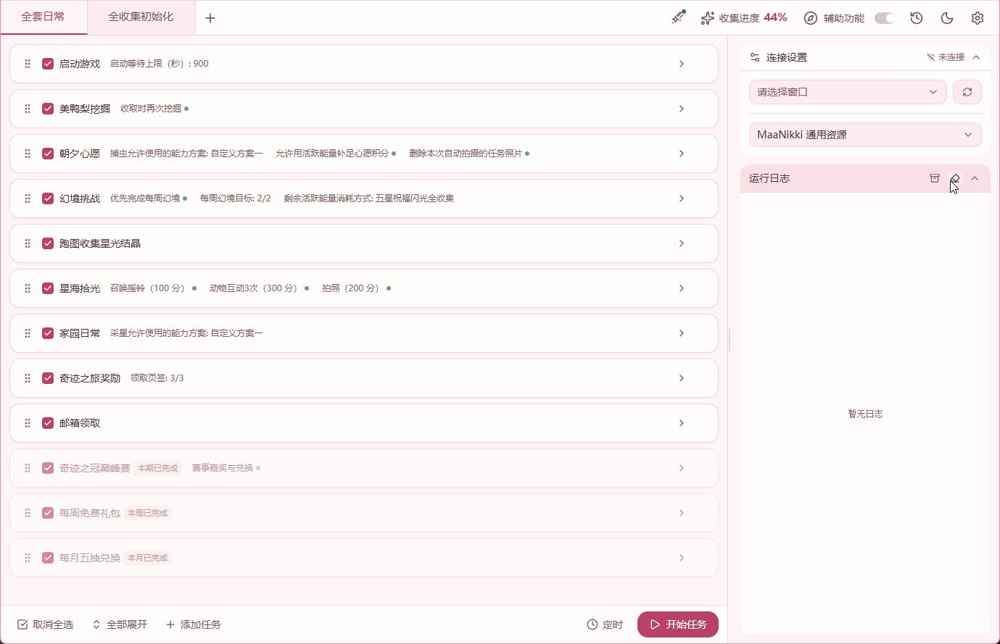
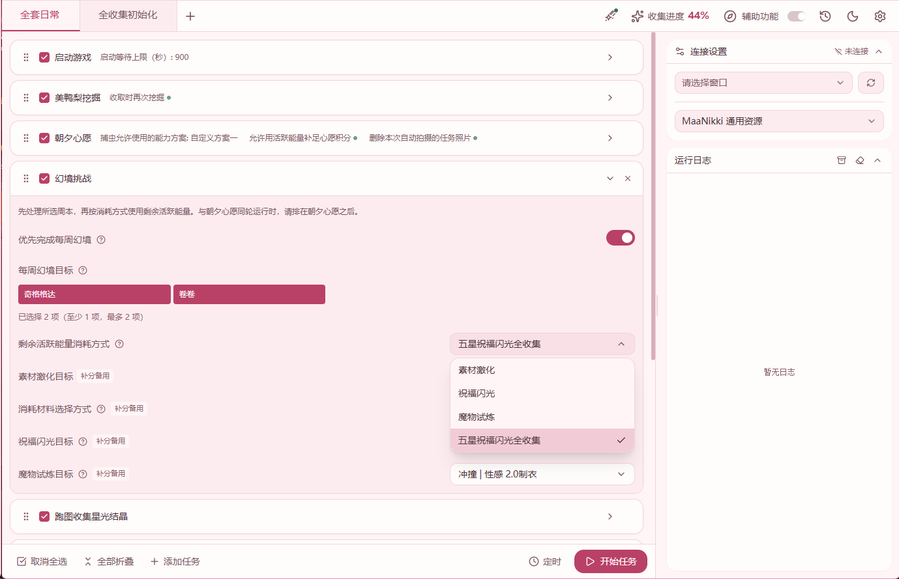
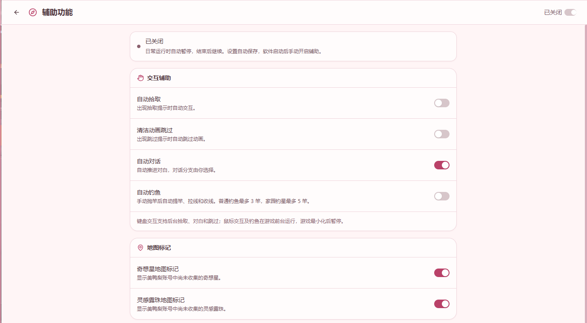
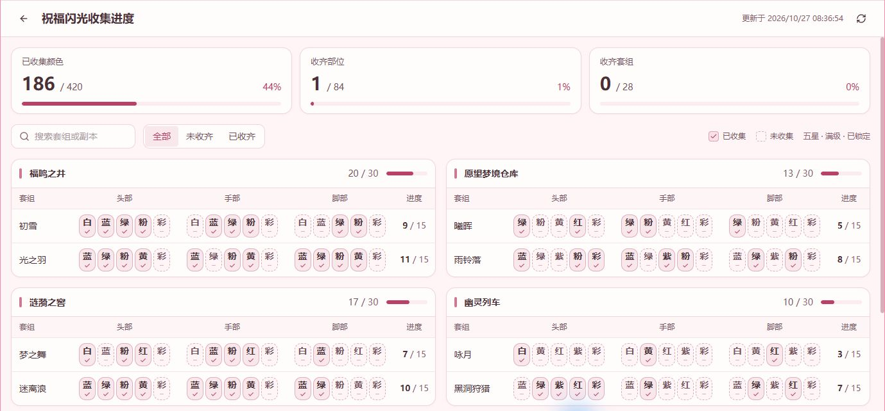

# MaaNikki 用户手册

[返回首页](../README.md) · [更新日志](../CHANGELOG.md) · [问题反馈](https://github.com/architect9331/MaaNikki/issues)

欢迎使用 MaaNikki！从日常领奖到祝福闪光追全，按自己的习惯安排任务就好。

## 目录

- [快速开始](#快速开始)
- [配置与运行](#配置与运行)
- [日常与周期任务](#日常与周期任务)
- [幻境挑战](#幻境挑战)
- [祝福闪光全收集](#祝福闪光全收集)
- [辅助功能与钓鱼](#辅助功能与钓鱼)
- [进度与账号数据](#进度与账号数据)
- [更新与日志](#更新与日志)
- [常见问题](#常见问题)

## 快速开始

1. 从 [Releases](https://github.com/architect9331/MaaNikki/releases) 下载 **Windows x64 运行包**，完整解压到一个文件夹，启动 `MaaNikki.exe`。
2. 将游戏设为 **16:9**，推荐 **1920×1080**，在 MaaNikki 中核对游戏按键。
3. 选择「**全套日常**」预设，勾选需要的任务，展开任务选项调整设置。
4. 确认相关地图、传送点、能力和关卡已经解锁，开始运行。

想追全祝福闪光？先运行「**全收集初始化**」，再按[全收集流程](#祝福闪光全收集)开启自动刷取。

## 配置与运行

### 游戏与按键

游戏实际画面保持 16:9；最大化窗口后也请核对画面比例。软件会在尺寸不符时显示当前截图尺寸。

自动路线使用前台输入，运行时保持游戏在前台。切出游戏后，相关流程暂停，切回继续。

捕虫、钓鱼和家园钓星可选择允许使用的能力方案。软件优先沿用轮盘中已有的能力，需要补充时配置所选方案。

### 任务预设

| 预设 | 内容 |
| --- | --- |
| 全套日常 | 启动游戏、挖掘、朝夕心愿、幻境挑战、星光结晶、星海拾光、家园与领奖、商城、巅峰赛 |
| 全收集初始化 | 启动游戏、祝福闪光仓库读取 |

可新建配置页签，保存自己的任务组合。朝夕心愿排在幻境挑战之前，跑图收集星光结晶排在星海拾光之前。

「启动游戏」优先于其他任务执行。可填写官方启动器 `launcher.exe` 路径，留空时自动查找。

### 定时执行

设置运行时间并保持 MaaNikki 运行。定时启动使用当前任务配置，游戏窗口、按键和前台要求与手动启动相同。

## 日常与周期任务

### 美鸭梨挖掘

领取挖掘奖励，默认沿用当前目标再次派遣。关闭「收取时再次挖掘」后，领取本轮奖励即结束。

### 朝夕心愿

优先完成采集植物、捕虫、打怪、拍照等已适配项目，按当天任务补足 **500 分**并领奖。

「允许用活跃能量补足心愿积分」默认开启。需要幻境补分时，使用幻境挑战中设置的目标与材料，按游戏默认最少次数挑战。同轮幻境挑战清理活跃能量后，会复核累计消耗对应的积分。

小游戏、升级祝福闪光和制作服装类心愿请手动完成。任务照片默认保留，可在选项中开启自动删除。

### 星海拾光

按勾选的子任务补足 **500 分**并领奖，15 项已适配子任务默认开启：

| 类型 | 项目 |
| --- | --- |
| 互动 | 动物互动 3 次、不同动物互动、聚会聊天 |
| 拍照 | 拍照、星愿瓶合影、星芒之翼合影 |
| 操作 | 摇铃、放置摆饰、星绘图册点赞、更改音乐、召唤流星 |
| 收集 | 投递信笺、制造泡泡、收集星光结晶、漂流瓶查看 |

展开任务选项可查看 **8 天轮换表**和各组可达积分。缺分的组合标黄，显示需要开启或手动完成的项目。

椰果采摘与拍照、星愿碎片投递与拍照、泡泡合影、海螺活动及跳上泡泡请手动完成。制造泡泡需准备对应能力。

聚会聊天会向已识别的聚会频道发送一次配置中的消息。任务照片默认保留，领奖默认开启。

调度优先完成摇铃和常规互动，随后处理合影、信笺、泡泡及按需收集结晶，最后尝试漂流瓶。达到 500 分后领取奖励。

### 跑图收集星光结晶

独立的每日采集任务，默认排在星海拾光之前。提前解锁所需地图与传送点，运行后自动摇铃、定位结晶并选择路线。

路线卡住超过 **30 秒**时，传送回起点重试，最多额外重试 **3 次**。每次导航时限为 15 分钟，切出游戏的暂停时间另计。

跑完后读取大地图右上角统计，依次输出 **星之魄、星光结晶、星光微尘**的今日累计和本趟新增。

星海拾光中的同名子任务在当天需要补分时调用这套流程。独立每日任务按自己的勾选状态运行。

### 家园日常

沿路线完成钓星、下落攻击、点赞与领奖，根据首个钓星点的进度选择后续路线。可设置采星能力方案。

任务结束时检查巨陨星提示，右上角显示观测结果。发现巨陨星后由你前往处理。

### 奇迹之旅与邮箱

「奇迹之旅奖励」可分别勾选旅行任务、旅行秘宝和乐园构想。旅行任务领取后统一领取秘宝；乐园构想入口可用时领取任务奖励，活动结束后继续处理奇迹之旅。

「邮箱领取」默认排在奇迹之旅之后，领取邮件中全部可领取的附件。

### 商城与巅峰赛

| 任务 | 行为与设置 |
| --- | --- |
| 每周免费礼包 | 领取虹迹赠礼、芳馨赠礼、星实置业之礼，逐项保存状态 |
| 每月五抽兑换 | 使用静谧水滴，兑换启示水晶、共鸣水晶各 5 个，保存两类商品的进度 |
| 奇迹之冠巅峰赛 | 使用游戏推荐搭配挑战已解锁关卡并领奖；成绩取决于衣柜与养成 |

巅峰赛「赛事嘉奖与兑换」默认关闭。开启后按商品清单顺序使用赛事货币兑换，商品名用逗号分隔，留空时只领取嘉奖。

周期任务保留勾选，完成后自动跳过，新周期恢复运行。周期均以**北京时间凌晨 4 点**切换：

| 任务 | 切换日期 |
| --- | --- |
| 每周免费礼包 | 每周一 |
| 每月五抽兑换 | 每月 1 日 |
| 巅峰赛 | 每月 1 日、16 日 |

## 幻境挑战

先完成所选的每周幻境，再按「剩余活跃能量消耗方式」处理剩余体力。

| 消耗方式 | 设置内容 |
| --- | --- |
| 素材激化 | 选择奖励，按数量最多或首选／备选顺序使用材料 |
| 普通祝福闪光 | 选择副本，快速挑战获取胚子 |
| 五星祝福闪光全收集 | 按收藏记录选缺色副本，刷取后处理新增胚子 |
| 魔物试炼 | 按所需材料选择关卡 |

提前解锁对应关卡、困难难度和快速挑战。各消耗方式的目标均可编辑；标为「补分备用」的选项供朝夕心愿按当天要求使用。

## 祝福闪光全收集

### 第一次使用

1. 清除游戏祝福闪光仓库的筛选。
2. 运行「**全收集初始化**」，完整执行「**祝福闪光仓库读取**」。
3. 打开右上角「**收集进度**」，查看已确认的五星满级颜色。
4. 在日常配置中将「**幻境挑战 → 剩余活跃能量消耗方式**」设为「**五星祝福闪光全收集**」。
5. 运行日常，后续按保存的收藏记录继续追全。

### 仓库读取与锁定

任务以「获得时间：从新到旧」读取头部、手部、脚部，按款式、部位和颜色保留满级收藏，每种颜色锁定一件。三星满级为 5 级，四星、五星满级为 10 级。

默认保留已有锁定，并补锁缺少的满级颜色。开启「**解锁不符合要求的祝福闪光**」后，会同时解锁未满级项和多余重复项。

三个部位读完并完成数量核对后，保存全收集基准。读取中断时，重新完整运行此任务。月桂兔等限定闪光按实际持有情况记录。

### 每次运行会做什么

1. 读取已保存的进度，按设置处理每周幻境。
2. 按各副本缺少的五星满级颜色数量排序，同分按图鉴顺序，选择当前可快速挑战的副本。
3. 使用剩余活跃能量刷取一批。关卡缺失或快速挑战不可用时，依次尝试后续候选。
4. 分解四星及以下未锁定闪光，再读取剩余新增区域。
5. 优先继续上次未升完的对象，再处理旧队列和本批新胚子。
6. 满级后识别颜色，锁定新颜色；重复颜色作为后续升级素材。
7. 保存结果，日志显示本轮新增颜色和当前进度。

同一部位优先处理较早获得的胚子。每轮根据当前缺色选择一个可用副本集中刷取，下次运行时重新选择。

**素材使用**：升级采用游戏「五星及以下素材」一键放入，会消耗未锁定五星胚子；刷取后会分解四星及以下未锁定闪光。请提前锁定要保留的物品。

追全范围为本地图鉴中的**五星满级颜色**。三星、四星用于仓库记录与材料处理。

### 材料不足与继续处理

缺噗灵或升级材料时，保存当前对象后正常结束，下次优先继续。需要噗灵时，可将幻境挑战改为素材激化，或通过其他方式补充。

活跃能量用完后仍可处理已有胚子。全部颜色收齐后，日志提示调整幻境用途。

| 想做什么 | 使用入口 |
| --- | --- |
| 刷取胚子 | 幻境挑战 → 普通祝福闪光 |
| 升级已有胚子 | 仅升级整理五星祝福闪光 |
| 自动刷取并追全颜色 | 幻境挑战 → 五星祝福闪光全收集 |
| 更新完整仓库记录 | 祝福闪光仓库读取 |

### 什么时候重新读取仓库

手动获得的新胚子会纳入新增区域处理。手动升级、解锁、分解，大量调整库存，或收到基准失效提示后，请重新运行「祝福闪光仓库读取」。

出现图鉴外闪光提示时，先将需要保留的闪光手动锁定，再重新读取仓库。新套组的追全范围随图鉴更新。

## 辅助功能与钓鱼

### 右上角辅助功能

点击右上角「**辅助功能**」图标或文字打开设置，旁边的开关控制启停。选项独立保存，每次启动软件后手动开启。

美鸭梨账号也在本页管理。

| 功能 | 使用方式 |
| --- | --- |
| 自动拾取 | 识别交互提示后拾取 |
| 自动对话 | 自动推进对白，分支由你选择 |
| 清洁动画跳过 | 手动开始清洁后，出现提示时跳过动画；部分剧情动画共用该提示 |
| 自动钓鱼 | 手动抛竿后接管提竿、拉线和收线；普通钓鱼默认最多 3 竿，家园钓星最多 5 竿 |

运行日常时辅助自动暂停，日常结束后按开关状态恢复。

交互键设为键盘按键时，拾取等辅助可在游戏切到后台后运行；鼠标交互在前台执行。游戏最小化时暂停，自动钓鱼切出游戏时暂停。

### 奇想星与灵感露珠标记

1. 在「辅助功能」的地图标记设置中登录**美鸭梨国服账号**。
2. 开启需要显示的奇想星、灵感露珠标记，再开启辅助功能开关。
3. 在游戏中打开大地图，等待自动识别缩放并完成校准。
4. 返回场景后，在小地图查看附近点位。

支持奇迹大陆、万相境和 16:9 游戏画面。未收集进度约每 15 秒从美鸭梨读取一次。副本收集点显示在入口，相同坐标合并显示数量。

切出游戏、进入其他页面或定位中断时，标记暂时隐藏；恢复有效定位后继续显示。

### 当前点钓鱼与路线钓鱼

「**当前点钓鱼**」：先站在钓点面向水面，再启动任务。软件准备能力并自动抛竿，默认最多 3 次，鱼钓光后结束。

「**路线钓鱼**」：选择路线后自动传送、前往各钓点。每点抛竿次数可单独设置，留空时使用路线默认值；鱼钓光后前往下一点。

「钓鱼前打窝」需解锁万物交响能力。两类任务均可选择允许使用的能力方案。

## 进度与账号数据

右上角「**收集进度**」按副本、套组和部位展示已确认满级且锁定的五星颜色，支持搜索与筛选未收齐项目。「巨陨星」显示当天的家园观测结果。

`config/account_state.json` 统一保存周期任务状态、祝福闪光收藏和仓库处理进度。祝福闪光记录包括：

- 名称、部位、星级、等级、颜色、数量及锁定状态。
- 仓库读取结果、获得时间顺序、待升级队列和上次未完成对象。
- 各副本缺少的颜色、本轮新增颜色及升级结果。

数量复核期间保留已确认收藏。完整字段说明见[开发文档](architecture.md#祝福闪光数据与诊断)。

**切换游戏账号**：先退出 MaaNikki，备份并移走 `config/account_state.json` 和旧的 `config/blessing/`，再启动软件、读取新账号仓库。配置页签用于保存任务组合，收藏与周期记录共用当前本地账号状态。

## 更新与日志

### 软件更新

启动时从 GitHub 检查最新公开版本，包括预发布版，后台下载 Windows x64 运行包，任务空闲时提示安装。也可在设置中手动检查更新、配置网络代理。

更新优先使用增量包以减少下载量，需要时自动改用完整包。下载前自动比较 GitHub 与 GH-Proxy 的速度，优先选择更快的线路，连接失败或持续低速时自动换线。

### 查看与导出日志

软件端显示任务开始、结果和异常，祝福闪光新增收藏会即时显示；日志文件保留详细过程。

日志面板的清空按钮仅清空展示，启动时默认自动清空展示。日志文件可在「设置 → 调试设置」确认清理，也可设置保留 7／30／90 天，每周自动检查一次；默认保留全部。

| 位置 | 内容 |
| --- | --- |
| `debug/messages/` | 详细任务消息 |
| `debug/on_error/` | 失败现场截图与识别摘要 |
| `logs/navigation/` | 导航、传送和路线执行记录 |
| `logs/blessing-lock/` | 仓库读取与锁定记录 |
| `logs/blessing-pursuit/` | 全收集与升级记录 |

遇到问题可使用软件的「**导出日志**」，附上运行时间和当时的操作，发到 QQ 群 **654174255** 或 [Issue](https://github.com/architect9331/MaaNikki/issues)。祝福闪光导出包含读取、追全各最近两轮的报告与图片，文件较多时分卷保存。

### 帮助改进软件

正式运行包默认开启「设置 → 通用 → 帮助改进软件」。开启时向 Sentry 发送崩溃、版本、硬件摘要、任务统计，以及失败任务的相关日志和截图；该选项可随时关闭，本地日志继续保存。

错误截图保留游戏画面，并遮罩左下角 UID 区域。日志正文与画面中可能包含的账号信息，在分享前请自行检查。

## 常见问题

| 情况 | 处理方式 |
| --- | --- |
| 提示截图尺寸不符 | 将实际游戏画面调整为 16:9，核对最大化后的比例，再运行任务 |
| 全收集提示需要初始化 | 清除仓库筛选，完整运行「祝福闪光仓库读取」 |
| 升级因缺噗灵结束 | 补充噗灵后继续；可将幻境挑战改为素材激化 |
| 地图标记暂时消失 | 切回游戏，打开所选地图的大地图，等待定位完成 |
| 需要调试单条路线 | 在「设置 → 调试设置」开启开发模式，使用「路线测试」；入口与记录见[开发文档](architecture.md#开发模式) |
